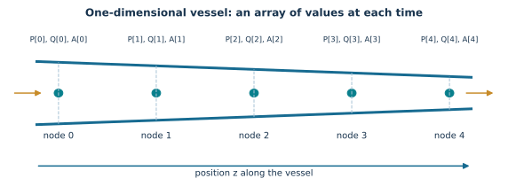
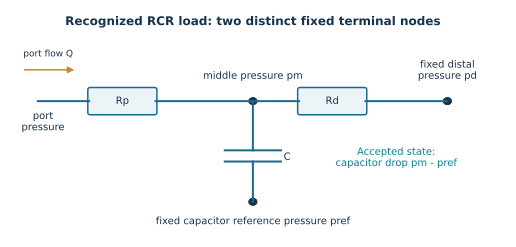
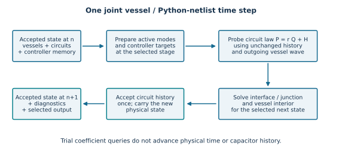
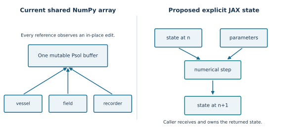

# STARFiSh and Python CRIMSON: Mathematics and JAX Porting Guide

A learning document for a reader starting without prior knowledge of blood-flow modelling, numerical methods, NumPy, or JAX.

Prepared: 19 October 2026.

Source basis: the current working copies of STARFiSh at `/home/sadid/starfish` and the standalone Python netlist project at `/home/sadid/crimson/cfs_reg/CRIMSONFlowsolver/flowsolver/netlist_py`. Their repository base commits at inspection were `b9f5484` and `4d94268`, respectively. A base commit is a reference point, not a claim that the working tree is unmodified.

This is an explanatory document and a proposed porting design. No numerical solver was changed to produce it. Existing tests and documentation were inspected; scientific accuracy, performance, and the full compatibility of the two projects were not established by running them.

## How to read this guide

The central idea is that STARFiSh models blood moving through flexible tubes, while the Python CRIMSON netlist models connected pressure-flow components. A simulation advances both systems through many small time steps. JAX changes how those calculations are represented and executed; it does not decide which physical equations are correct.

Three labels distinguish statements throughout this document:

- **Physical model:** the mathematical relationship being represented.
- **Current implementation:** what the inspected source actually calculates.
- **Proposed JAX port:** a design to implement and compare; it is not already installed in STARFiSh.

An explanation of a standard physical equation is not proof that every current code path discretizes it identically. Where the source differs, the difference is described explicitly.

Read chapters 1-5 first for the vocabulary. Chapters 6-15 explain the STARFiSh mathematics and algorithms. Chapters 16-20 explain the Python netlist and how to couple it to STARFiSh. Chapters 21-26 explain postprocessing, uncertainty, JAX, and the software changes. Chapters 27-30 cover verification, delivery, and guided exercises. The appendices provide a symbol dictionary, source map, feature inventory, and references.

You do not need to memorize the equations. For each equation, first ask: what quantities go in, what comes out, and what changes when time advances?

## 1. What the two simulators represent

### 1.1 A vessel is a flexible tube

Imagine a long, flexible hose. Pumping fluid into it produces both motion of fluid and a change in the hose's width. A pressure disturbance can travel along the hose much faster than an individual parcel of fluid.

STARFiSh represents a vessel using values at several positions along its length. At each position it tracks:

- Pressure: how strongly the fluid pushes.
- Flow: how much fluid crosses the section per second.
- Area: the size of the opening through which the fluid moves.

A network connects vessels at branches and joins. The connections must conserve flow and satisfy the selected pressure relationship.

### 1.2 What “1D” means

“1D”, or one dimensional, means that the main independent spatial coordinate follows the vessel's length. The code does not compute a separate velocity at every point across the circular section.

A cross-section-averaged velocity and a profile assumption replace the detailed cross-sectional velocity field. This saves a great deal of computation, but it is a modelling approximation.

The vessel can still have a position and orientation in three-dimensional space. That orientation affects gravity and visualization. It does not turn the fluid calculation into a full three-dimensional flow calculation.

### 1.3 What “0D” means

A zero-dimensional model has no resolved distance along a vessel. Instead, components relate pressure, flow, and stored volume.

Examples are:

- A resistance: a pressure difference drives a flow.
- A compliance: pressure rises when additional volume is stored.
- An inertance: changing flow requires a pressure difference.
- A diode or valve: a component changes behavior according to its state.
- A pressure chamber: pressure depends on stored volume and chamber stiffness.

The Python CRIMSON netlist is such a component network. Its graph describes which components connect which pressure nodes.

### 1.4 Why combine them?

A detailed arterial segment may be represented by a 1D vessel. Smaller downstream vessels may be represented by a 0D circuit. The circuit determines the load felt at the end of the vessel.

The interface has a pressure and a flow. Those values must agree between the two models after allowing for units and the chosen positive flow direction.

The Python netlist is already a standalone project with readable `*_reference.py` and JAX `*_jax.py` implementations. The proposed integration is direct Python-to-Python. A C++ worker and embedded Python 2 runtime are historical features of the current STARFiSh adapter, not requirements of the target integration.

Source: [Python netlist project overview](/home/sadid/crimson/cfs_reg/CRIMSONFlowsolver/flowsolver/netlist_py/README.md).



## 2. Numbers, units, and symbols

### 2.1 The quantities that appear most often

| Symbol | Meaning | Usual STARFiSh unit |
| --- | --- | --- |
| \(z\) | Position along a vessel | metre, m |
| \(t\) | Time | second, s |
| \(P\) | Pressure | pascal, Pa |
| \(Q\) | Volumetric flow | cubic metre per second, m³/s |
| \(A\) | Vessel cross-sectional area | square metre, m² |
| \(r\) | Vessel radius | metre |
| \(v\) | Mean fluid velocity | metre per second |
| \(\rho\) | Fluid density | kilogram per cubic metre |
| \(\mu\) | Dynamic viscosity, resistance to shear | Pa s |
| \(c\) | Pressure-wave speed | metre per second |
| \(g_\parallel\) | Gravity acceleration projected along a vessel | m/s² |

A symbol is a name for a number, or for many numbers indexed by space and time. In code, \(\rho\) is usually `rho`, \(\mu\) is `my`, and \(z\) is `z`.

### 2.2 Flow is not velocity

The relationship is

\[
v=\frac{Q}{A},\qquad Q=Av.
\]

A flow of \(10^{-5}\) m³/s through an area of \(10^{-4}\) m² gives a mean velocity of \(0.1\) m/s.

If the same amount of fluid per second passes through half the area, the mean velocity doubles. This matters at constrictions and when calculating kinetic pressure.

### 2.3 Unit conversions

STARFiSh commonly uses these conversion factors:

\[
1\ {\rm mL}=10^{-6}\ {\rm m}^3,
\qquad
1\ {\rm mmHg}\approx133.32\ {\rm Pa}.
\]

For example,

\[
80\ {\rm mmHg}\approx10665.6\ {\rm Pa},
\qquad
100\ {\rm mL/s}=10^{-4}\ {\rm m}^3/{\rm s}.
\]

Use the exact conversion convention selected by the application when comparing results. Changing 133.32 to a more precise constant can change the last digits of a reference comparison.

A number such as `80.0` has no unit attached to it in an ordinary NumPy or JAX array. Code must interpret and convert it correctly.

### 2.4 Several symbols have more than one meaning

The two most important ambiguities are compliance and matrix names.

Vessel area compliance is

\[
C_A=\frac{dA}{dP}.
\]

Its units are m²/Pa.

Lumped volume compliance is

\[
C_V=\frac{dV}{dP}.
\]

Its units are m³/Pa. The code often calls both quantities `C`; they cannot be substituted for each other.

The characteristic transformation matrices are called `R` and `L`. A circuit resistance is also often called \(R\), and a circuit inertance \(L\). This guide writes the characteristic matrices as \(\mathsf R\) and \(\mathsf L\) when confusion is possible.

A general circuit matrix is written \(\mathcal M\), so it is not confused with vessel area \(A\).

### 2.5 Dimensional checking

A valid physical equation adds quantities with the same units.

For example, resistance satisfies

\[
\Delta P=R_{\rm res}Q.
\]

Therefore resistance has units Pa s/m³. Multiplying it by m³/s gives Pa.

Dimensional checking does not prove an algorithm is correct. It can expose a wrong coefficient, a missing conversion, or a formula that has been transcribed incorrectly.

## 3. The small amount of mathematics needed to read the solver

### 3.1 Functions

A function is a rule that turns inputs into outputs. If area depends on pressure, write

\[
A=f(P).
\]

In Python, the same idea is `area = area_from_pressure(pressure, parameters)`.

A function can return more than one value. A simulation step can return the next state and information about whether the calculation succeeded.

### 3.2 Differences and derivatives

A difference compares two values:

\[
\Delta P=P_{\rm new}-P_{\rm old}.
\]

A derivative measures how rapidly a quantity changes. The time derivative of pressure is approximately

\[
\frac{dP}{dt}\approx\frac{P(t+\Delta t)-P(t)}{\Delta t}
\]

when the time interval \(\Delta t\) is small.

A spatial derivative compares nearby positions:

\[
\frac{\partial P}{\partial z}
\approx\frac{P(z+\Delta z,t)-P(z,t)}{\Delta z}.
\]

The symbol \(\partial\) is used when a quantity depends on more than one variable. Pressure depends on both position and time; \(\partial P/\partial t\) changes time while holding position fixed.

### 3.3 Integrals

An integral adds many small contributions. The volume in a vessel is

\[
V=\int_0^\ell A(z)\,dz.
\]

Here \(\ell\) is vessel length. A constant area gives \(V=A\ell\). A changing area needs a numerical approximation to the integral.

Similarly,

\[
V(t+\Delta t)-V(t)
=\int_t^{t+\Delta t}(Q_{\rm in}-Q_{\rm out})\,d\tau.
\]

This says that stored volume grows by the amount entering minus the amount leaving.

### 3.4 Vectors and matrices

A vector is an ordered list of numbers. For example,

\[
u=\begin{bmatrix}P\\Q\end{bmatrix}.
\]

A matrix is a rectangular arrangement of numbers. Multiplying a two-by-two matrix by this vector gives

\[
\begin{bmatrix}a&b\\c&d\end{bmatrix}
\begin{bmatrix}P\\Q\end{bmatrix}
=
\begin{bmatrix}aP+bQ\\cP+dQ\end{bmatrix}.
\]

The positions of the entries matter. Swapping two flow entries without changing the matrix columns changes the problem being solved.

### 3.5 Solving a linear system

The equation

\[
\mathcal Mx=b
\]

represents several simultaneous equations. The matrix \(\mathcal M\) contains their coefficients, \(x\) contains the unknown values, and \(b\) contains known forcing and history.

For example,

\[
\begin{aligned}
p_1-p_2&=8,\\
p_2&=3
\end{aligned}
\]

has \(p_2=3\) and \(p_1=11\).

NumPy uses `np.linalg.solve(M, b)`; JAX uses `jnp.linalg.solve(M, b)`. A matrix can fail to have a unique solution, for example if a circuit has no pressure reference.

### 3.6 Nonlinear equations and roots

An equation is nonlinear when the unknown appears in expressions such as a square, a logarithm, or a pressure-dependent area.

Write the equation as

\[
F(x)=0.
\]

The function \(F\) is the residual: it reports how far the trial value \(x\) is from satisfying the equation.

For \(F(x)=x^2-4\), \(F(3)=5\), while \(F(2)=0\). A root finder repeatedly chooses new trial values.

A root finder can converge to the wrong root or fail to converge. Its initial guess, stopping criterion, and failure behavior are part of the implementation.

### 3.7 Jacobians

For several residual equations, the Jacobian contains how each residual changes when each unknown changes:

\[
J_{ij}=\frac{\partial F_i}{\partial x_j}.
\]

Newton's method approximately solves

\[
J(x_k)\Delta x=-F(x_k),\qquad
x_{k+1}=x_k+\Delta x.
\]

The subscript \(k\) counts nonlinear iterations within one physical time step. It is different from the simulation time-step index \(n\).

## 4. Arrays and the existing Python program

### 4.1 What NumPy adds to Python

An array stores many numbers with one shape and numerical type. An array of five pressure values might be:

```python
pressure = np.array([10000., 10020., 10010., 9990., 9980.])
```

Its shape is `(5,)`. A time history with 100 saved times and five positions has shape `(100, 5)`.

The expression `pressure + 10` adds 10 to every entry. The expression `flow / area` computes velocity entry by entry.

### 4.2 Indices and slices

Python starts counting at zero. For five values, the positions are 0, 1, 2, 3, and 4.

- `P[0]`: first value.
- `P[-1]`: last value.
- `P[1:-1]`: all interior values, excluding both endpoints.
- `P[1:] - P[:-1]`: differences between neighboring values.
- `Psol[n, i]`: pressure at time-buffer row \(n\), spatial point \(i\).

If a vessel has \(N\) nodes, adjacent differences have \(N-1\) entries. Interior node updates usually have \(N-2\) entries.

### 4.3 Shape and broadcasting

Broadcasting allows an array operation to use a scalar or certain smaller arrays across larger arrays.

A scalar has shape `()`. A one-element vector has shape `(1,)`. They contain the same number of values but behave differently in shape checks and indexing.

Current characteristic routines sometimes return `domega[0]` because a gravity value has kept the intermediate result as a one-element array. A port that changes this to a scalar must update the surrounding shape contract.

An especially dangerous mistake is multiplying shape `(N,)` by shape `(N, 1)`: broadcasting can produce an `(N, N)` array instead of \(N\) values.

### 4.4 Objects and shared references

A Python object bundles named values and methods. A vessel object contains geometry, material parameters, and solution arrays.

The current field constructor does this:

```python
self.P = vessel.Psol
self.Q = vessel.Qsol
self.A = vessel.Asol
```

These assignments do not make three new copies. The field and vessel refer to the same arrays. Connections, boundaries, and the memory manager keep other references to them.

A later assignment such as `self.P[n+1, i] = value` changes the shared array. The other objects see the update.

This behavior is central to the current architecture, not an incidental coding detail.

Source: [field constructor](../SolverLib/classFields.py).

### 4.5 The current run sequence

The high-level path is:

```text
read XML and create network objects
    -> initialize geometry, wall laws, initial values
    -> choose a time step
    -> allocate solution buffers and output datasets
    -> construct field, boundary, and connection objects
    -> build an ordered list of numerical operations
    -> repeat that list at each time step
    -> record output and roll buffers as needed
```

The main time loop is `FlowSolver.MacCormack_Field`. The list contains spatial field updates, endpoints, junctions, optional communicators, venous feedback, global network updates, and memory-management operations.

Some calculations explicitly depend on being called last. Preserving the mathematical formulas while changing the operation order can still change the simulation.

Source: [solver and operation schedule](../SolverLib/class1DflowSolver.py).

## 5. Space, time, and initial conditions

### 5.1 Building the vessel grid

A uniform spatial grid has

\[
z_i=i\Delta z,\qquad
\Delta z=\frac{\ell}{N-1},\qquad i=0,\ldots,N-1.
\]

A 0.2 m vessel with five nodes has \(\Delta z=0.05\) m.

The source constructs `z` with `np.linspace(0, length, N)` and `dz` with `np.diff(z)`.

### 5.2 Geometry functions

For a uniform radius \(r_a\),

\[
A_0(z)=\pi r_a^2.
\]

For the cone geometry, radius varies linearly:

\[
r(z)=r_a+(r_b-r_a)\frac z\ell,
\qquad A_0(z)=\pi r(z)^2.
\]

For the constriction geometry, the implemented radius is

\[
r(z)=r_a+(r_b-r_a)
\frac{1+\cos(\pi(2z/\ell-1))}{2}.
\]

It equals \(r_a\) at the ends and \(r_b\) at the center. The source warns that this geometry was not verified and validated. Another geometry helper, `mtStig2016`, exits before performing its proposed calculation.

Porting should distinguish working geometry formulas from present but unsupported paths.

Source: [grid functions](../NetworkLib/moduleGrids.py).

### 5.3 Initial conditions versus boundary conditions

An initial condition describes the whole network at the starting time. A boundary condition describes what is imposed at an endpoint during the run.

Examples:

- Initial pressure everywhere: 100 mmHg.
- Inlet boundary: flow varies periodically with time.
- Outlet boundary: pressure depends on a downstream circuit.

A correct inlet condition does not determine the pressure at every interior node at the starting time; initialization still matters.

STARFiSh supports several initialization approaches, including constant pressure and steady resistance-network calculations.

### 5.4 A steady resistance network

For steady flow through a vessel,

\[
P_{\rm start}-P_{\rm end}=R_v Q.
\]

At a branch,

\[
Q_{\rm mother}=Q_{\rm daughter1}+Q_{\rm daughter2}.
\]

These equations can be assembled into one linear system for initial pressures and flows. Terminal loads add downstream resistance.

The implementation contains conversions between SI units and pressure/flow scales used inside its initialization matrix. A JAX rewrite must preserve or explicitly replace those conversions consistently.

A global node label, a vessel ID, and a matrix column index are different concepts. The current initialization code includes arithmetic based on vessel IDs; a new explicit lookup table is easier to audit for nonconsecutive IDs.

Source: `calculateInitialValuesLinearSystem` in [network implementation](../NetworkLib/classVascularNetwork.py).

### 5.5 The time step and CFL idea

An explicit method must not let information travel too far across the grid in one step.

For a wave speed \(c\), a common bound is

\[
\Delta t\leq {\rm CFL}\frac{\Delta z}{c}.
\]

CFL is a chosen fraction such as 0.5. If \(\Delta z=0.01\) m and \(c=5\) m/s, CFL = 0.5 gives \(\Delta t=0.001\) s.

The current time-step initialization uses estimated wave speeds and a global minimum. It computes

\[
N_t=\left\lceil\frac{T_{\rm total}}{\Delta t}\right\rceil
\]

and may include an initialization period.

The ceiling symbol means round upward to an integer.

For the full characteristic system, signal speeds also include fluid velocity; a general stability study should examine \(\max|\lambda_\pm|\), introduced later. That is an audit question, not permission to change the current time-step formula during a parity port.

The source calculates proposed grid corrections, but the inspected selection disables applying them. Do not turn the configuration flag into a newly active behavior accidentally.

### 5.6 Gravity and vessel orientation

Only the component of gravity along a vessel drives axial motion. If \(\hat t\) is a unit vector along the vessel and \(\mathbf g\) is the gravity vector,

\[
g_\parallel=\mathbf g\cdot\hat t.
\]

The dot means add the products of matching vector entries.

A three-dimensional rotation matrix changes local vessel directions into global directions. Tilt stimuli make orientation and gravity vary with time. Hydrostatic pressure changes scale as \(\rho g\) times a vertical displacement, with sign determined by the coordinate convention.

The current code precomputes position, rotation, gravity, and venous-pressure histories. Those arrays are inputs to the numerical step. If tilt parameters later become optimization variables, the path that computes these inputs must also preserve their dependence on those parameters.

## 6. The physical equations inside a vessel

### 6.1 Conservation of fluid volume

If more fluid enters a short segment than leaves it, the segment must expand. The one-dimensional continuity equation is

\[
\frac{\partial A}{\partial t}
+\frac{\partial Q}{\partial z}=0.
\]

If \(Q\) decreases in the forward direction, \(\partial Q/\partial z<0\), so area increases.

For a pressure-dependent wall with area compliance \(C_A=dA/dP\),

\[
\frac{\partial A}{\partial t}
=C_A\frac{\partial P}{\partial t}
\]

when the wall law has no additional explicit time dependence. Therefore,

\[
\frac{\partial P}{\partial t}
+\frac1{C_A}\frac{\partial Q}{\partial z}=0.
\]

This explains the current coefficient `m12 = 1.0 / C`.

### 6.2 Conservation of momentum

A representative cross-section-averaged momentum equation is

\[
\frac{\partial Q}{\partial t}
+\frac{\partial}{\partial z}
\left(\delta\frac{Q^2}{A}\right)
+\frac A\rho\frac{\partial P}{\partial z}
=
-\frac{2\pi(\gamma+2)\mu}{\rho}\frac QA
+A g_\parallel.
\]

The terms represent:

- Change of flow over time.
- Transport of momentum by fluid motion.
- Acceleration caused by the pressure gradient.
- Viscous resistance to motion.
- Gravity.

The profile exponent is \(\gamma\), and the momentum correction factor is

\[
\delta=\frac{\gamma+2}{\gamma+1}.
\]

For \(\gamma=2\), \(\delta=4/3\).

This is the model-level explanation. The two implemented field schemes use different numerical expressions, discussed in chapter 9.

### 6.3 A pressure-flow matrix form

For constant \(\delta\) and no additional explicit spatial wall-law dependence, expand the momentum transport derivative using \(v=Q/A\) and \(\partial A/\partial z=C_A\partial P/\partial z\). The resulting coefficient form is

\[
u_t+\mathsf M u_z=b,\qquad
u=\begin{bmatrix}P\\Q\end{bmatrix},
\]

\[
\mathsf M=
\begin{bmatrix}
0&1/C_A\\
A/\rho-\delta C_Av^2&2\delta v
\end{bmatrix},
\]

\[
b=
\begin{bmatrix}
0\\
-2\pi(\gamma+2)(\mu/\rho)v+A g_\parallel
\end{bmatrix}.
\]

If reference geometry or the wall law changes explicitly with position, the derivative expansion needs corresponding care. This local derivation is not a complete proof for every nonuniform vessel model.

### 6.4 Wave speed

The wave-speed formula used by STARFiSh is

\[
c=\sqrt{\frac{A}{\rho C_A}}.
\]

A stiffer wall has smaller compliance and therefore a larger wave speed.

For \(A=10^{-4}\) m², \(\rho=1000\) kg/m³, and \(C_A=10^{-8}\) m²/Pa,

\[
c=\sqrt{10}=3.16227766\ {\rm m/s}.
\]

The code uses this relationship in `Vessel.waveSpeed`. Negative area or compliance is not a meaningful input for the intended model.

### 6.5 The coefficients returned by the source

The current `System.updateSystem` returns

\[
\begin{aligned}
m_{12}&=1/C_A,\\
m_{21}&=C_A(c^2-\delta v^2)
      =A/\rho-\delta C_Av^2,\\
m_{22}&=2\delta v,\\
b_2&=-2\pi(\gamma+2)(\mu/\rho)v+A g_\parallel.
\end{aligned}
\]

Those formulas match the coefficient interpretation above. How the field method applies them must be checked separately.

Sources: [system coefficients](../SolverLib/classSystemEquations.py), [wave speed](../NetworkLib/classVessel.py).

## 7. All implemented wall-law families

A wall law supplies area and area compliance for a given pressure. The port needs both the full-vessel version and the single-node version.

Define transmural pressure

\[
p=P-P_{\rm ext},
\]

where \(P_{\rm ext}\) is pressure outside the vessel. In the formulas below, \(A_s\) and \(P_s\) are the code's reference parameters. Parameter values may vary across nodes.

### 7.1 Exponential family

The implemented formula is

\[
A=A_s\left(1+\frac{\log(p/P_s)}{\beta_E}\right),
\qquad
C_A=\frac{A_s}{\beta_Ep}.
\]

The logarithm requires \(p/P_s>0\).

For a derivative check, differentiating \(\log p\) gives \(1/p\), which produces the displayed compliance.

### 7.2 Laplace family

The implemented pressure-area relationship is

\[
A=\left(\frac{p-P_s}{\beta_L}+\sqrt{A_s}\right)^2.
\]

Write the bracket as \(s(P)\). Since \(A=s^2\),

\[
C_A=2s\frac{ds}{dP}
=\frac{2}{\beta_L}
\left(\frac{p-P_s}{\beta_L}+\sqrt{A_s}\right).
\]

This is the source's formula. At \(p=P_s\), the area equals \(A_s\).

A worked example in consistent SI units uses

\[
A_s=10^{-4},\quad
P_s=10000,\quad
P_{\rm ext}=0,\quad
\beta_L=10^6,\quad
P=11000.
\]

Then the bracket is \(0.011\) m, area is \(1.21\times10^{-4}\) m², and compliance is \(2.2\times10^{-8}\) m²/Pa.

The coefficient \(\beta_L\) carries the units required by this formula. Do not assume every parameter named beta is dimensionless.

### 7.3 Laplace2

Laplace2 uses the same area and compliance formulas, but initializes stiffness from wall thickness \(h\) and Young's modulus \(E_Y\):

\[
\beta_L=\frac43
\frac{\sqrt{\pi}\,h E_Y}{A_s}.
\]

Young's modulus measures material stiffness. It is different from the chamber elastance \(E(t)\) introduced later.

### 7.4 Hayashi

The implemented law is

\[
A=A_s\left(1+\frac{\log(p/P_s)}{\beta_H}\right)^2,
\]

\[
C_A=
\frac{2A_s}{\beta_Hp}
\left(1+\frac{\log(p/P_s)}{\beta_H}\right).
\]

The square makes this different from the exponential family's area formula. Again, the logarithm needs a positive argument.

### 7.5 HayashiEmpirical

The area and compliance formulas have the Hayashi form. The initialization attempts to estimate \(\beta_H\) using an empirical area-wave-speed relationship.

The inspected method refers to `Amm` without defining it in that method. This is a source-level defect to resolve before declaring that initialization path supported. A port must not quietly invent its missing definition and call the result equivalent.

The related empirical formulas elsewhere use area converted to mm² and expressions of the form

\[
c_{\rm emp}
=\frac{13.3}{\left(\sqrt{4A_{\rm mm^2}/\pi}\right)^{0.3}}.
\]

These are unit-dependent fitted formulas, not dimensionless identities. Their original unit convention must remain explicit.

### 7.6 Reymond

Define

\[
x=\frac{p-P_{\max}}{P_{\rm width}},
\]

with source constants \(a_1=0.4\), \(b_1=5\), and configured pressure scales. The compliance is

\[
C_A=C_s\left(a_1+\frac{b_1}{1+x^2}\right).
\]

The corresponding area is

\[
A=C_s\left(a_1p+
b_1P_{\rm width}\arctan x\right)+K,
\]

\[
K=A_s-C_s\left(
a_1P_s+
b_1P_{\rm width}
\arctan\frac{P_s-P_{\max}}{P_{\rm width}}
\right).
\]

The constant \(K\) makes the reference area match the selected reference pressure under this convention.

### 7.7 Constant compliance and rigid area are different options

The constant-compliance option returns a precomputed compliance vector, `C0preCalculated`, instead of reevaluating the variable compliance formula.

The rigid-area option prevents selected time-step operations from updating area.

They are different switches. Freezing one quantity does not automatically freeze every pressure-dependent value elsewhere. The JAX parameter contract should preserve their separate meanings.

### 7.8 What changes in JAX?

The formulas remain the same. Parameters and pressure arrays become explicit inputs.

```python
# Proposed numerical function, not an installed STARFiSh API.
def laplace_area(pressure, area_ref, pressure_ref,
                 beta, external_pressure):
    p = pressure - external_pressure
    return ((p - pressure_ref) / beta
            + jnp.sqrt(area_ref)) ** 2
```

Material adaptation should return new parameter arrays rather than mutate a wall object. Exact Python-type checks such as `type(alpha_c) in [float, int, np.float64]` must not reject valid JAX scalar inputs inside transformed calculations.

Keep the existing compliance formula for initial parity. Compare it with the derivative of the area formula as a separate mathematical check.

Source for this chapter: [wall laws](../NetworkLib/classCompliance.py).


## 8. Resistance, volume, and other integral calculations

### 8.1 Viscous vessel resistance

A steady vessel resistance relates pressure drop to flow:

\[
P_{\rm start}-P_{\rm end}=R_vQ.
\]

For the profile convention in the source,

\[
R_v=2(\gamma+2)\pi\mu
\int_0^\ell\frac{1}{A(z)^2}\,dz.
\]

For a constant circular radius,

\[
R_v=\frac{2(\gamma+2)\mu\ell}{\pi r^4}.
\]

At \(\gamma=2\), this becomes the familiar expression \(8\mu\ell/(\pi r^4)\). A small radius change has a large effect because radius appears to the fourth power.

### 8.2 What the tapered-resistance implementation actually integrates

`Vessel.calcResistance` creates 101 points by default. It linearly interpolates **area** between the proximal and distal areas, computes \(1/A^2\), and integrates with SciPy's Simpson routine.

The cone grid, by contrast, linearly interpolates **radius**. Linear radius gives quadratic area. These are different spatial profiles.

A port that substitutes the analytic resistance of a radius-linear cone would therefore change the current resistance calculation. Preserve the sampled calculation first; evaluate any physical correction separately.

### 8.3 Simpson integration

For an odd number of equally spaced samples \(f_0,\ldots,f_{2m}\), spacing \(h\), composite Simpson integration is

\[
\int f(z)\,dz\approx
\frac h3\left(
f_0+f_{2m}
+4\sum_{\text{odd }j} f_j
+2\sum_{\substack{\text{even }j\\0<j<2m}} f_j
\right).
\]

It approximates the curve using quadratic pieces. For the default 101-point resistance calculation, the basic odd-sample formula is sufficient.

The function accepts a different integration count. A feature-complete replacement must decide how to handle small counts, even counts, and any nonuniform coordinates rather than assuming every caller uses 101.

SciPy can remain in setup initially. A small dedicated JAX quadrature function is useful when resistance must depend differentiably on geometry.

### 8.4 Volume of a vessel segment

If radius varies linearly over a segment of length \(h\), its volume is

\[
V_{\rm segment}
=\frac h3\left(A_i+\sqrt{A_iA_{i+1}}+A_{i+1}\right).
\]

The square-root term comes from the product of the two endpoint radii. The network code sums this expression over adjacent nodes and vessels.

This is different from the trapezoidal area formula \(h(A_i+A_{i+1})/2\). Replacing one with the other changes reported volume.

The inspected global-volume function also adds venous volume inside its vessel loop. That appears to add the same venous compartment once per vessel. It needs a separate baseline decision before using that output as a mass-balance oracle.

Sources: [vessel resistance](../NetworkLib/classVessel.py), `calculateNetworkVolume` in [network calculations](../NetworkLib/classVascularNetwork.py).

## 9. The MacCormack field methods, step by step

### 9.1 Why a numerical method is needed

The continuous equations describe values at every location and every time. A computer stores a finite number of values.

A numerical method replaces derivatives by neighboring differences and advances by a finite time interval. This approximation is called a discretization.

MacCormack uses two stages:

1. A predictor produces a trial future state.
2. A corrector combines the original state with information from the predictor.

For smooth solutions under suitable assumptions, this structure can provide second-order accuracy. Boundaries, sources, and coupling can lower the order of the complete simulation.

### 9.2 A scalar teaching example

Consider a simpler transport equation,

\[
u_t+a u_z=0,
\]

where \(a\) is a constant speed. The value \(u\) moves along the grid.

The predictor is

\[
u_i^*=u_i^n
-\nu(u_{i+1}^n-u_i^n),
\qquad \nu=\frac{a\Delta t}{\Delta z}.
\]

The corrector is

\[
u_i^{n+1}
=\frac12\left(
u_i^n+u_i^*
-\nu(u_i^*-u_{i-1}^*)
\right).
\]

The superscript \(n\) means the old time; the star means the predictor.

For old values \((1,2,4,7)\) and \(\nu=0.25\), the predictor values for the first three positions are \(0.75,1.5,3.25\). Keeping the last predictor boundary value at 7, the corrected values at the two interior positions are 1.65625 and 3.40625.

This is a teaching example of the two-stage structure. It is not a blood-flow reference test.

### 9.3 The current flux function

The default field option is `MacCormack_Flux`. Its helper `F` returns, for \(u=(P,Q)\),

\[
F(u;A,A_f,C_f)=
\begin{bmatrix}
Q/C_f\\
A_fP/\rho+\alpha_F Q^2/A
\end{bmatrix}.
\]

Here \(A_f,C_f\) are frozen values selected for a finite-difference pair.

**Current implementation:** the helper sets \(\alpha_F=1\). The surrounding method calculates \((\gamma+2)/(\gamma+1)\), but that local value is not used by `F`.

Consequently, replacing \(\alpha_F\) with \(\delta=(\gamma+2)/(\gamma+1)\) would change the current flux method. A physically motivated change must not be hidden inside the JAX port.

### 9.4 Exact predictor structure in the flux path

For each left point \(i=0,\ldots,N-2\), define a face difference using the same frozen \(A_i^n,C_i^n\) in both flux evaluations:

\[
u_i^*=u_i^n
-\frac{\Delta t}{\Delta z}
\left[
F(u_{i+1}^n;A_{i+1}^n,A_i^n,C_i^n)
-
F(u_i^n;A_i^n,A_i^n,C_i^n)
\right].
\]

The flow component then receives

\[
\Delta t\left[
-\frac{2\pi(\gamma+2)\mu}{\rho}\frac{Q_i^n}{A_i^n}
+A_i^n g_\parallel^n
\right].
\]

If area is not rigid, the code evaluates the wall law and compliance at the predicted pressure to obtain \(A^*,C^*\).

The source uses `dx = self.dz[0]`, so this implementation assumes equally spaced grid intervals.

### 9.5 Exact corrector structure in the flux path

The backward difference uses the predicted right-point area and compliance as the frozen coefficients:

\[
u_i^{n+1}
=\frac12\left[
u_i^n+u_i^*
-\frac{\Delta t}{\Delta z}
\left(
F(u_i^*;A_i^*,A_i^*,C_i^*)
-F(u_{i-1}^*;A_{i-1}^*,A_i^*,C_i^*)
\right)
\right].
\]

The flow receives half a time step of the corresponding predicted friction and gravity term.

Only the interior entries are written to the vessel solution. Endpoints are handled by boundary and connection objects.

This frozen-coefficient implementation should be ported literally before trying to replace it with a different conservative flux or a new finite-volume scheme.

### 9.6 The matrix path and a discrepancy that matters

The alternative `MacCormack_Matrix` method uses the coefficients from chapter 6.

Its pressure predictor has the expected form

\[
P_i^*=P_i^n
-\Delta t\,m_{12,i}^n
\frac{Q_{i+1}^n-Q_i^n}{\Delta z_i}.
\]

The flow predictor in the inspected code is

\[
Q_i^*=Q_i^n-\Delta t\left[
m_{21,i}^n D^+P_i^n
+m_{22,i}^n D^+\left(\frac{(Q_i^n)^2}{A_i^n}\right)
-b_{2,i}^n
\right],
\]

where \(D^+f_i=(f_{i+1}-f_i)/\Delta z_i\).

The standard local matrix interpretation in chapter 6 instead applies \(m_{22}=2\delta v\) to \(D^+Q\), not to \(D^+(Q^2/A)\).

This distinction is visible in the source variable `dQ2dz`. A dimensional check also raises a concern: \(m_{22}D_z(Q^2/A)\) does not have the units of a flow time derivative under the stated SI meanings.

The corrector repeats the implemented structure with predicted coefficients and backward differences, then averages with the old state.

This is a **source-level equation discrepancy**, not a runtime validation result. The port needs an explicit decision: preserve the current matrix algorithm for comparison, repair it under a separate approved model change, or exclude the path until its intended formula is established.

### 9.7 What changes in JAX?

The predictor and corrector can be pure array functions. They need explicit inputs for old pressure, flow, area, geometry, wall parameters, gravity, and time step.

Instead of writing into another object's history array, the field function can return three interior arrays. The driver then combines interior and endpoint results into the next vessel state.

Prefer direct construction and slicing to many scalar updates:

```python
# Proposed assembly pattern.
next_pressure = jnp.concatenate((
    left_pressure[None],
    interior_pressure,
    right_pressure[None],
))
```

This example assumes endpoint pressures are scalar JAX arrays. A different shape contract needs a corresponding implementation.

Source for this chapter: [field schemes](../SolverLib/classFields.py).

## 10. Characteristics: how an endpoint knows what the interior is doing

### 10.1 Information travels in two directions

A subcritical flexible-vessel model normally has one wave traveling in the positive vessel direction and one in the negative direction.

At a distal endpoint, the interior tells us about the forward-going wave. The boundary must determine the incoming backward-going wave.

At a proximal endpoint, the roles reverse.

Imposing both arbitrary pressure and arbitrary flow would generally overconstrain such a boundary. The characteristic formulation supplies the missing relationship.

### 10.2 Characteristic speeds

The simplified model uses

\[
\lambda_+=c,\qquad \lambda_-=-c.
\]

The full model uses

\[
\lambda_\pm
=\delta v\pm
\sqrt{c^2+\delta(\delta-1)v^2}.
\]

These are eigenvalues of the local system matrix. An eigenvalue is a speed at which a particular combination of pressure and flow propagates.

The code chooses simplified or full speeds and chooses pressure-based or flow-based characteristic coordinates. These choices create four implementation variants.

### 10.3 Impedance

For the full model, define

\[
Z_+=\frac1{C_A\lambda_+},
\qquad
Z_-=-\frac1{C_A\lambda_-}.
\]

For the simplified model, both reduce to

\[
Z_c=\frac1{C_Ac}=\frac{\rho c}{A}.
\]

Impedance has units Pa s/m³. It describes the pressure change associated with a traveling flow disturbance.

### 10.4 Changing coordinates

Let the characteristic increments be

\[
\omega=
\begin{bmatrix}\omega_+\\\omega_-\end{bmatrix}.
\]

The pressure and flow increments are

\[
\begin{bmatrix}\Delta P\\\Delta Q\end{bmatrix}
=\mathsf R\omega,
\qquad
\omega=\mathsf L
\begin{bmatrix}\Delta P\\\Delta Q\end{bmatrix}.
\]

Ideally \(\mathsf L\mathsf R=I\), where \(I\) is the identity matrix.

These increments are numerical local wave coordinates. They are not an additional physical volume compartment.

### 10.5 Pressure-based coordinates

With \(S=Z_++Z_-\), the full pressure-coordinate matrices are

\[
\mathsf R_P=
\begin{bmatrix}
Z_+/S&Z_-/S\\
1/S&-1/S
\end{bmatrix},
\qquad
\mathsf L_P=
\begin{bmatrix}
1&Z_-\\
1&-Z_+
\end{bmatrix}.
\]

For the simplified case,

\[
\mathsf R_P=
\begin{bmatrix}
1/2&1/2\\
1/(2Z_c)&-1/(2Z_c)
\end{bmatrix}.
\]

Both entries of \(\omega\) then carry pressure units.

### 10.6 Flow-based coordinates

The full flow-coordinate matrices are

\[
\mathsf R_Q=
\begin{bmatrix}
Z_+&Z_-\\
1&-1
\end{bmatrix},
\qquad
\mathsf L_Q=
\begin{bmatrix}
1/S&Z_-/S\\
1/S&-Z_+/S
\end{bmatrix}.
\]

For equal impedances, the first column of \(\mathsf L_Q\) is \(1/(2Z_c)\), while its second column is \(1/2,-1/2\).

The characteristic values now have flow units. A tolerance for \(\omega\) must respect the selected coordinate system.

### 10.7 Following a wave backward

To estimate the known characteristic increment at a boundary, trace the outgoing wave backward by one step:

\[
z_{\rm foot}=z_{\rm boundary}-\lambda_{\rm outgoing}\Delta t.
\]

The code interpolates old pressure and flow at that position:

\[
\Delta u_{\rm foot}
=
\begin{bmatrix}
P(z_{\rm foot})-P(z_{\rm boundary})\\
Q(z_{\rm foot})-Q(z_{\rm boundary})
\end{bmatrix}.
\]

It multiplies the appropriate row of \(\mathsf L\) by this difference and adds its gravity contribution:

\[
\omega_{\rm known}
=\mathsf L_{\rm outgoing}\Delta u_{\rm foot}
+\Delta t\,L_{{\rm outgoing},Q}A_{\rm boundary}g_\parallel.
\]

At the distal end it uses \(\lambda_+\); at the proximal end it uses \(\lambda_-\).

### 10.8 What changes in JAX?

Return newly calculated matrices and characteristic values instead of overwriting `self.R`, `self.L`, `self.LAMBDA`, and scratch arrays.

One-dimensional interpolation has a JAX equivalent, `jnp.interp`. Preserve endpoint extrapolation behavior and shape conventions.

The code's current scalar consistency expression is not a full matrix identity check. A clear comparison can also inspect every entry of \(\mathsf L\mathsf R-I\).

Source: [all four characteristic routines](../SolverLib/classSystemEquations.py).

## 11. Native inlet and outlet conditions

### 11.1 A common algebraic pattern

Write the characteristic matrix as

\[
\mathsf R=
\begin{bmatrix}r_{11}&r_{12}\\r_{21}&r_{22}\end{bmatrix}.
\]

At a distal endpoint, \(\omega_+=k\) is known and \(\omega_-=w\) is unknown:

\[
P'=P+r_{11}k+r_{12}w,
\qquad
Q'=Q+r_{21}k+r_{22}w.
\]

A prime denotes the proposed next endpoint value. Substitute these expressions into the boundary equation and solve for \(w\).

At a proximal endpoint, \(\omega_-=k\) is known and \(\omega_+=w\) is unknown.

### 11.2 Prescribing total flow

If the desired next flow is \(Q_{\rm target}\), the distal condition gives

\[
w=\frac{Q_{\rm target}-Q-r_{21}k}{r_{22}}.
\]

A total pressure target similarly gives

\[
w=\frac{P_{\rm target}-P-r_{11}k}{r_{12}}.
\]

Use the appropriate unknown column at a proximal endpoint. A near-zero denominator signals a problematic boundary formulation.

### 11.3 Prescribing an increment

The code also supports prescribed influxes and increments. A supplied increment is not always an absolute next-step value.

For a waveform \(U(t)\), the base implementation can form

\[
\Delta U^n=U(t_{n+1})-U(t_n)
\]

and combine it with outgoing and reflected characteristic contributions.

The distinction between prescribed total values and prescribed increments must survive the port. A sine-shaped increment produces a different result from a sine-shaped absolute flow.

### 11.4 Reflection coefficient

A simple characteristic reflection condition has the form

\[
\omega_{\rm incoming}
=R_t\omega_{\rm outgoing}
+\omega_{\rm prescribed}.
\]

Here \(R_t\) is a reflection coefficient. A value of zero removes the reflected contribution in this selected characteristic convention.

For the simplest equal-impedance pressure-wave setting, a resistive termination has the familiar relation

\[
R_t=\frac{R_{\rm load}-Z_c}{R_{\rm load}+Z_c}.
\]

This interpretation depends on the wave normalization and the boundary orientation. Preserve the actual \(\mathsf R,\mathsf L\) conventions.

### 11.5 Resistance

The physical distal load usually has

\[
P_{\rm interface}-P_v=R_{\rm load}Q_{\rm out}.
\]

The current native `Resistance` characteristic methods enforce the incremental distal relation

\[
\Delta P=R_{\rm load}\Delta Q.
\]

They do not use old pressure and flow to explicitly restore an absolute pressure-flow balance. The absolute relationship follows only when the existing state is already consistent with it.

This differs from the netlist affine interface, whose intercept carries history and pressure-reference terms explicitly.

### 11.6 Two-element Windkessel

A resistor and compliance in parallel satisfy

\[
C_V\frac{dP}{dt}
=Q_{\rm out}-\frac{P-P_v}{R_c}.
\]

The time constant is \(R_cC_V\), in seconds.

For constant \(P_v\), a centered/trapezoidal step yields

\[
\left(1+\frac{2R_cC_V}{\Delta t}\right)\Delta P
-R_c\Delta Q
=
2\left(R_cQ-(P-P_v)\right).
\]

Substituting the characteristic increments gives the source's direct endpoint formula. The proximal formula uses the corresponding opposite outlet-flow orientation.

The native routine uses current venous pressure in its formula. A time-varying reference pressure requires preserving the exact sampled time level used by the source.

### 11.7 Three-element Windkessel

A proximal impedance \(Z\), distal resistance \(R_c\), and compliance \(C_V\) satisfy

\[
P=P_c+ZQ,
\qquad
C_V\frac{dP_c}{dt}
=Q-\frac{P_c-P_v}{R_c}.
\]

Eliminating \(P_c\) gives

\[
R_cC_V\frac{dP}{dt}
-ZR_cC_V\frac{dQ}{dt}
+P-P_v-(Z+R_c)Q=0.
\]

The current native method defines

\[
a=ZR_cC_V+\frac{\Delta t}{2}(Z+R_c),
\qquad
b=R_cC_V+\frac{\Delta t}{2}.
\]

For a distal endpoint, its characteristic result is

\[
w=
\frac{
\Delta t(P-P_v)-\Delta t(Z+R_c)Q
+(br_{11}-ar_{21})k
}{
ar_{22}-br_{12}
}.
\]

When `Z` is `VesselImpedance`, this model can capture the impedance on its first use and reuse that value. That first-run behavior is part of the boundary state.

**Important distinction:** the native Windkessel discretization and the Python netlist's backward-Euler RCR discretization are different. Identical component names do not make their discrete trajectories identical.

### 11.8 DAE variants

A differential-algebraic equation combines a time derivative with an algebraic constraint.

The general boundary wrapper maps a trial characteristic value into \(\Delta P,\Delta Q\) and calls a residual. For the two-element DAE, the intended backward-Euler residual is

\[
F=C_V\frac{\Delta P}{\Delta t}
+\frac{P+\Delta P-P_v}{R_c}
-(Q+\Delta Q).
\]

The inspected Windkessel DAE call signatures are inconsistent with the general wrapper's area argument. Repair and validate those paths before using them as reference behavior.

The current SciPy `newton` calls omit `fprime`, so they use a secant iteration. Preserve that fact when comparing a new root solver.

For a scalar residual, the secant iteration is

\[
w_{k+1}
=w_k-F(w_k)
\frac{w_k-w_{k-1}}{F(w_k)-F(w_{k-1})}.
\]

It estimates a slope using two trial points instead of an analytic derivative. A small residual difference can make that slope unreliable.

SciPy's selected tolerance controls the change in the root estimate; it is not simply an absolute residual tolerance. Its initial second point, maximum iterations, and nonconvergence behavior must also match the chosen library version for a strict numerical comparison.

For a teaching example \(F(w)=w^2-4\), trial points 1 and 3 produce the next point \(3-5(3-1)/(5-(-3))=1.75\). Later iterations approach a root.


Source: [boundary models](../NetworkLib/classBoundaryConditions.py). External reference: [SciPy newton](https://docs.scipy.org/doc/scipy/reference/generated/scipy.optimize.newton.html).

## 12. Prescribed waveforms and interpolation

### 12.1 Basic periodic waveforms

A simple periodic signal can be written

\[
Q(t)=Q_0+B\sin(2\pi f(t-t_0)).
\]

The frequency \(f\) is cycles per second, the period is \(1/f\), and \(B\) is amplitude.

STARFiSh provides sinusoidal, ramp, exponential, physiological, Fourier, and sampled-file waveform families. Pulse schedules add start times, active intervals, spacing, and runtime period changes.

These waveform functions can be converted to JAX arithmetic, but pulse schedule state and boundary interpretation must also be carried.

### 12.2 Fourier representation

A Fourier waveform combines harmonics:

\[
Q(t)=a_0+\sum_{m=1}^{K}
\left[a_m\cos(2\pi mf t)+b_m\sin(2\pi mf t)\right].
\]

A harmonic is a multiple of the base frequency. Fixed harmonic count is straightforward for JAX. Changing the number of terms changes the array shape and may require compilation of another program.

### 12.3 File-based periodic data

The current `FlowFromFile` implementation loads time/value samples and evaluates a periodic time

\[
t_{\rm sample}
=t_{\rm first}
+\operatorname{mod}(t-t_{\rm pulse},T_{\rm file}).
\]

It then interpolates the samples. Before the pulse starts, it returns the configured constant contribution.

File loading belongs outside compiled calculations. The loaded samples can become explicit arrays passed to `jnp.interp`.

### 12.4 Linear interpolation explained

Given adjacent samples \((x_0,y_0)\) and \((x_1,y_1)\),

\[
w=\frac{x-x_0}{x_1-x_0},
\qquad
y(x)=(1-w)y_0+wy_1.
\]

For values 10 at time 0 and 14 at time 2, time 0.5 gives \(w=0.25\) and value 11.

A JAX port must preserve what happens outside the sample interval and at the periodic seam.

### 12.5 Two-dimensional result interpolation

Saved pressure has a time dimension and a spatial dimension. A query at a new time and position uses interpolation in both.

On a rectangular grid, bilinear interpolation combines four surrounding values:

\[
f=(1-a)(1-b)f_{00}
+a(1-b)f_{10}
+(1-a)bf_{01}+abf_{11}.
\]

The weights \(a,b\) describe relative position between the neighboring coordinates.

The current `getSolutionData` uses removed SciPy `interp2d` calls. A replacement must preserve output orientation: requested times correspond to rows and requested positions to columns.

Sources: [waveform and file implementations](../NetworkLib/classBoundaryConditions.py), [result accessor](../NetworkLib/classVascularNetwork.py). External references: [SciPy interp2d removal](https://docs.scipy.org/doc/scipy/reference/generated/scipy.interpolate.interp2d.html), [JAX regular-grid interpolation](https://docs.jax.dev/en/latest/_autosummary/jax.scipy.interpolate.RegularGridInterpolator.html).

## 13. Junctions, nonlinear iteration, and the Jacobian issue

### 13.1 What a junction solves

A link connects two vessels. A bifurcation connects one incoming vessel to two outgoing vessels. An anastomosis joins two incoming vessels to one outgoing vessel.

Each endpoint supplies one known characteristic. The junction determines the remaining incoming characteristic at each endpoint.

### 13.2 Conservation equations

For a link,

\[
F_1=Q_1-Q_2=0.
\]

For a bifurcation,

\[
F_1=Q_1-Q_2-Q_3=0.
\]

For an anastomosis,

\[
F_1=Q_1+Q_2-Q_3=0.
\]

The signs refer to each vessel's configured direction. A negative solved flow is possible and must not be replaced by its absolute value.

### 13.3 Total pressure

The nonlinear implementation compares

\[
H_j=P_j+\frac{\rho_j}{2}
\left(\frac{Q_j}{A_j}\right)^2.
\]

This combines static pressure and kinetic pressure.

The bifurcation residuals are

\[
F_2=H_1-H_2,\qquad F_3=H_1-H_3.
\]

For an anastomosis, the source compares \(H_1-H_3\) and \(H_2-H_3\).

These equations are nonlinear because flow is squared and area depends on pressure.

### 13.4 Expressing everything using characteristic unknowns

For a mother vessel ending at the junction,

\[
P_1=P_{1,0}+r_{11}^{(1)}k_1+r_{12}^{(1)}w_1,
\]

\[
Q_1=Q_{1,0}+r_{21}^{(1)}k_1+r_{22}^{(1)}w_1.
\]

For a daughter starting at the junction,

\[
P_2=P_{2,0}+r_{11}^{(2)}w_2+r_{12}^{(2)}k_2,
\]

\[
Q_2=Q_{2,0}+r_{21}^{(2)}w_2+r_{22}^{(2)}k_2.
\]

Areas are evaluated from those trial pressures unless the rigid-area option is selected.

Thus the unknown vector has two entries for a link and three for a bifurcation or anastomosis.

### 13.5 The implemented Jacobian is approximate for flexible areas

Consider one total-pressure term,

\[
H=P+\frac{\rho Q^2}{2A(P)^2}.
\]

Its derivative with respect to a characteristic unknown \(w\) is

\[
\frac{dH}{dw}
=
\frac{dP}{dw}
+\frac{\rho Q}{A^2}\frac{dQ}{dw}
-\frac{\rho Q^2C_A}{A^3}\frac{dP}{dw}.
\]

The inspected junction Jacobian formulas include the first two terms but omit the last pressure-area derivative term.

For rigid area, that omitted dependence is absent. For flexible area, the formulas act as an approximate Jacobian for the nonlinear residual.

Automatic differentiation would include the full pressure-area derivative. It can improve the mathematical Jacobian, but it changes the iteration used by the current solver. Keep that improvement separate from the initial parity implementation.

### 13.6 Tolerances, guesses, and stopping

The source uses different thresholds for mass-flow and pressure residuals. A bifurcation uses approximately

\[
|F_1|\leq10^{-14},
\qquad |F_2|,|F_3|\leq10^{-3}
\]

under its current physical units. A link uses a \(10^{-4}\) pressure residual threshold.

It also uses previous pressure increments to form some initial guesses. Those guesses affect nonlinear convergence.

Current loops evaluate physical values at the current candidate and then compute another candidate. The returned physical values must be associated with the same candidate as the reference implementation. Simply returning the newest candidate from a generic solver can introduce an extra iteration.

Iteration limits use source-specific conditions such as `Niterations > 30`. Failure is not handled uniformly: some paths print diagnostics and break. The first port should make these behaviors visible and compare them before changing the policy.

### 13.7 Linear and stenosis methods

Linear junction formulas are present. A stenosis method adds a pressure-loss term of the form

\[
\Delta P_{\rm stenosis}
=
\rho v_1^2
\left[
\frac{K_v}{\operatorname{Re}_1}
+\frac{K_t}{2}
\left(\frac{A_1}{A_{\rm stenosis}}-1\right)^2
\right],
\]

where the Reynolds number is

\[
\operatorname{Re}_1=\frac{\rho v_1D_1}{\mu},
\qquad
D_1=\sqrt{\frac{4A_1}{\pi}}.
\]

The source uses a fixed area ratio in that method and a special small-Reynolds-number branch.

However, current connection constructors force the scheme to `NonLinear`. The existence of the linear and stenosis functions is not evidence that normal configuration selects them.

### 13.8 What changes in JAX?

A junction residual should return a numerical residual vector without changing solution arrays. The root solver should carry an explicit candidate, residual, iteration count, and status.

Use the legacy approximate Jacobian for the first comparison. A later path may use `jax.jacfwd` and a linear solve, after checking its numerical effects.

Carry enough previous state for warm starts. Distinguish the global time-step index from a rolling buffer index: current guesses can reset when the memory index returns to zero.

Source for this chapter: [connections](../SolverLib/classConnections.py).

## 14. Heart, valves, and local ODE integration

### 14.1 The heart chamber equation

A common time-varying elastance model uses

\[
P_h(t)=E_h(t)\left(V_h(t)-V_0\right).
\]

Here \(V_h\) is chamber volume, \(V_0\) is unstressed volume, and \(E_h\) is chamber elastance. Larger elastance means a larger pressure for the same excess volume.

Volume obeys

\[
\frac{dV_h}{dt}=Q_{\rm mitral}-Q_{\rm aortic}.
\]

This is the same inflow-minus-outflow conservation principle used elsewhere.

### 14.2 The source elastance waveform

The heart models use shapes based on

\[
s_1(t)=
\frac{(t/a_1)^{n_1}}{1+(t/a_1)^{n_1}},
\qquad
s_2(t)=\frac1{1+(t/a_2)^{n_2}},
\]

\[
E_h(t)=E_{\min}
+(E_{\max}-E_{\min})\alpha_Es_1(t)s_2(t).
\]

Several versions set \(a_1=0.708T_{\rm peak}\) and \(a_2=1.677a_1\). Other versions store equivalent shape parameters directly.

The time \(t\) here is cycle time. Cycle counters, period changes, and runtime elastance settings are state, not merely constants.

### 14.3 A continuously opening valve

Let \(\xi\) be a valve opening state between zero and one. The source's update has the form

\[
\xi'=
\begin{cases}
\min\left(1,\xi+(1-\xi)K_{\rm open}
(\Delta p-\Delta p_{\rm open})\Delta t\right),
&\Delta p>\Delta p_{\rm open},\\
\max\left(0,\xi+\xi K_{\rm close}
(\Delta p-\Delta p_{\rm close})\Delta t\right),
&\Delta p<-\Delta p_{\rm close},\\
\xi,&\text{otherwise}.
\end{cases}
\]

Notice the exact closing expression: its branch condition uses \(-\Delta p_{\rm close}\), while the rate expression contains \(\Delta p-\Delta p_{\rm close}\). Preserve this inspected expression until any physical correction is evaluated separately.

The effective opening area interpolates between minimum and maximum valve areas. The source derives coefficients including

\[
B=\frac{\rho}{2A_{\rm eff}^2},
\qquad
L_v=\frac{\rho\ell_{\rm eff}}{A_{\rm eff}}.
\]

A valve pressure-flow law then contains a nonlinear loss \(B Q|Q|\) and a flow-acceleration contribution.

Closed-valve cases use special branches. Some current functions return `None` for coefficients. A compiled numerical function should instead carry an explicit Boolean mode and valid fixed-shape numerical values for its active branch.

### 14.4 The more detailed heart residual system

The currently selected simple residual functions in `VaryingElastance` use unknown mitral-flow increment \(dQ_m\), ventricular-pressure increment \(dP_h\), and incoming aortic characteristic \(w\).

Define

\[
Q_a'=Q_a+r_{21}w+r_{22}k.
\]

The three residuals can be written

\[
F_m=
B_m(Q_m+dQ_m)|Q_m+dQ_m|
+\frac{L_m}{2\Delta t}(3dQ_m+Q_m^{n-1}-Q_m^n)
-P_{\rm atrium}+P_h+dP_h,
\]

\[
F_h=
E_h\left[
V_h-\frac{\Delta t}{2}
(r_{21}w+r_{22}k+2Q_a-2Q_m-dQ_m)-V_0
\right]-P_h-dP_h,
\]

\[
F_a=
B_aQ_a'|Q_a'|
+\frac{L_a}{2\Delta t}
(3r_{21}w+3r_{22}k-Q_a^n+Q_a^{n-1})
-P_h-dP_h+P_a+r_{11}w+r_{12}k.
\]

These are the unscaled simple functions actually selected by the inspected residual dispatcher. The source also contains alternative scaled expressions; those are not the selected function array.

Different valve modes select subsets of this system. The nonlinear solver uses handwritten inverse-Jacobian formulas and a relative iterate-change criterion.

### 14.5 The simpler heart ODE path

The `VaryingElastanceSimple` model uses local Forward Euler solves.

During filling,

\[
\dot V_h=\frac{P_{\rm atrium}-P_h}{R_v},
\]

\[
\dot P_h=\dot E_h(V_h-V_0)
+E_h\frac{P_{\rm atrium}-P_h}{R_v}.
\]

During ejection,

\[
\dot V_h=-Q_a,
\qquad
\dot P_h=\dot E_h(V_h-V_0)-E_hQ_a,
\]

with another characteristic-based equation for \(\dot Q_a\).

The source estimates \(\dot E_h\) with a forward difference using \(10^{-5}\) s. Replacing that with an exact derivative changes the numerical procedure and should be compared separately.

### 14.6 Forward Euler and RK4

For \(\dot u=f(u,t)\), Forward Euler is

\[
u^{n+1}=u^n+\Delta t\,f(u^n,t_n).
\]

Fourth-order Runge-Kutta evaluates four slopes:

\[
\begin{aligned}
k_1&=f(u^n,t_n),\\
k_2&=f(u^n+\tfrac{\Delta t}{2}k_1,t_n+\tfrac{\Delta t}{2}),\\
k_3&=f(u^n+\tfrac{\Delta t}{2}k_2,t_n+\tfrac{\Delta t}{2}),\\
k_4&=f(u^n+\Delta t k_3,t_n+\Delta t),
\end{aligned}
\]

\[
u^{n+1}
=u^n+\frac{\Delta t}{6}(k_1+2k_2+2k_3+k_4).
\]

The repository implements these locally in `ODESolver.py`. A JAX port can preserve them directly. Introducing a new adaptive ODE library is not required.

The local Backward Euler class depends on a `Newton` module that is not present in the inspected source inventory. Treat its support separately.

### 14.7 The DAE heart path

The DAE variant uses a scalar boundary residual during systole, reflection-like conditions when uncoupled, and explicit filling or isovolumetric steps.

Several residual methods write trial chamber values into `nmem+1`. The port should calculate those trial values locally, return the residual, and commit the accepted chamber state once after the solve.

The current Python array of functions and dynamically selected method names should become setup-time selection or explicit numerical branches.

### 14.8 What changes in JAX?

Use one explicit state containing chamber volume and pressure, valve states, prior flows needed by the integration scheme, cycle counters, and runtime parameters.

Use `lax.cond` or equivalent fixed-shape logic for valve modes. A two-variable branch and a three-variable branch need compatible returned state, even when their internal equation systems have different sizes.

Gradients inside a fixed mode can be useful. A gradient through a particular branch is not automatically a derivative of a valve's event time as a parameter changes.

Sources: [heart and valve implementations](../NetworkLib/classBoundaryConditions.py), [local ODE methods](../NetworkLib/ODESolver.py).

## 15. The venous pool and whole-network feedback

### 15.1 Volume and pressure

The dynamic venous model advances volume using

\[
V^{n+1}=V^n+\Delta t(Q_{\rm in}^n-Q_{\rm out}^n).
\]

Its pressure law in the source is

\[
P(V,V_{\rm usv})=
P_0\exp\left[
k\frac{((V-V_{\rm usv})10^6)^{1.5}}{V10^6}
\right].
\]

The factors \(10^6\) convert the stored volume scale before the empirical formula is evaluated. Dropping them would radically change the model.

The fractional power requires care when \(V<V_{\rm usv}\). Preserve the current diagnostic intent instead of silently clipping the difference.

### 15.2 Feedback to other components

The venous pool estimates inflow from selected terminal boundary models and outflow from proximal heart or vessel quantities. It calculates an atrial-pressure quantity using a gain and updates supported boundary reference pressures.

These updates create feedback:

\[
\begin{aligned}
\text{arterial outflow}
&\longrightarrow\text{venous volume and pressure}\\
&\longrightarrow\text{heart filling and outlet pressure}\\
&\longrightarrow\text{future arterial flow}.
\end{aligned}
\]

The order determines which quantities come from the old or new time level. A JAX state transition must make that timing explicit.

### 15.3 Why recording arrays are not the complete state definition

The minimal evolving state is not simply the last \(P,Q,A\) arrays. A heart may need an older flow; a junction may need a previous pressure increment; a controller may need an accumulated variable.

Conversely, the full recorded history is often much larger than the working state needed for the next step.

List every value read from earlier times before reducing state to a two-buffer implementation.

Source: [venous model](../NetworkLib/classVenousPool.py), [network end-of-step updates](../NetworkLib/classVascularNetwork.py).


## 16. The Python CRIMSON netlist: what already exists

### 16.1 Correcting the earlier integration assumption

The target project is the standalone Python package in:

```text
/home/sadid/crimson/cfs_reg/CRIMSONFlowsolver/flowsolver/netlist_py/
```

It already includes NumPy reference solvers, JAX numerical kernels, explicit-state trajectories, circuit parsing, diode logic, controller contracts, and optional C++-shaped lifecycle adapters.

Therefore the port does not need to reproduce those circuit equations from C++ or communicate with the old STARFiSh C++ worker.

It still needs a STARFiSh adapter. Two Python libraries do not automatically agree about units, ordering, state ownership, and time-step timing.

### 16.2 Existing module roles

| Existing Python netlist module | Responsibility |
| --- | --- |
| `CircuitData.py`, `NetlistXmlReader.py` | Model data and XML parsing |
| `NetlistCircuit_reference.py` | Readable matrix assembly and numerical solve |
| `NetlistCircuit_jax.py` | JAX matrix assembly, solves, interface coefficients |
| `RCR_reference.py`, `RCR_jax.py` | Strictly recognized standard-RCR reduction |
| `BoundaryConditionManager_reference.py`, `_jax.py` | Optional boundary lifecycle and state ownership |
| `CircuitData_diode_reference.py`, `_jax.py` | Diode state and graph reachability |
| `ControllerProtocol_reference.py`, `_jax.py` | Explicit controller inputs, outputs, and state |
| `ControlSystemsManager_reference.py`, `_jax.py` | Scheduling and controlled targets |
| `ClosedLoopDownstreamSubsection_reference.py`, `_jax.py` | Global downstream circuit composition |
| `pureZeroDDriver_reference.py`, `_jax.py` | Standalone and generated-replacement execution |

A file ending in `_jax.py` is not necessarily an entirely pure compiled API. For example, the boundary-manager implementation contains mutable Python objects around JAX kernels.

Use the pure numerical functions for a compiled STARFiSh time loop. Use the host manager lifecycle as a readable integration path where appropriate.

### 16.3 Scope of the existing project

The project documents reviewed support for selected resistor, capacitor, inductor, diode, volume-tracker, pressure-chamber, controller, and closed-loop paths. It explicitly limits parity claims to its fixtures and supported combinations.

Do not interpret the presence of every component class as proof that every arbitrary combined case is supported by every rollout API.

Kalman filtering and restart/split-run continuation are out of the Python netlist project's scope. Normal accepted state between ordinary time steps remains essential.

### 16.4 A concrete environment requirement

The inspected `pyproject.toml` declares:

```text
Python: >=3.14,<3.15
jax:    0.11.1
jaxlib: 0.11.1
numpy:  2.4.0
```

STARFiSh's Ubuntu and Fedora setup scripts default to Python 3.11.

For a direct in-process integration, both projects need a compatible Python environment. The installed versions of HDF5, Chaospy, GUI dependencies, and other STARFiSh packages must also be checked in that environment.

The netlist README mentions development evidence on Python 3.13, but that does not change the declared package installation target.

Sources: [package metadata](/home/sadid/crimson/cfs_reg/CRIMSONFlowsolver/flowsolver/netlist_py/pyproject.toml), [current documentation index](/home/sadid/crimson/cfs_reg/CRIMSONFlowsolver/flowsolver/netlist_py/docs/README.md).

## 17. Circuit mathematics from the beginning

### 17.1 A netlist is a graph

A graph contains nodes and connections. In a pressure-flow circuit:

- Nodes carry pressure values.
- Components connect start and end nodes.
- Each component has an oriented flow.

A positive component flow means flow from its start node to its end node. A component's positive direction may differ from the direction used by the external vessel.

### 17.2 Node conservation

At an internal node with no unmodelled storage,

\[
\sum Q_{\rm entering}-\sum Q_{\rm leaving}=0.
\]

This is often called Kirchhoff's current law, or KCL, because the same algebra is used for electrical currents. In this model, the conserved quantity is fluid flow.

Storage is represented explicitly by compliance or volume components, rather than by silently violating the node equation.

### 17.3 Resistor

For a resistance \(R_{\rm res}\),

\[
p_s-p_e-R_{\rm res}q=0.
\]

The matrix row contains \(+1\) for start pressure, \(-1\) for end pressure, and \(-R_{\rm res}\) for component flow.

### 17.4 Capacitor or compliance

A compliance satisfies

\[
q=C_V\frac{d(p_s-p_e)}{dt}.
\]

Using accepted pressures \(h_{p_s},h_{p_e}\) and a time increment \(d\), backward Euler gives

\[
p_s-p_e-h_{p_s}+h_{p_e}-\frac d{C_V}q=0.
\]

The letter \(h\) means accepted history. Both endpoint pressures matter, including a fixed-pressure endpoint.

For a passive RC discharge with \(R=2\), \(C=1\), old pressure 10, and step 0.1,

\[
p_{\rm new}=\frac{10}{1+0.1/(2\cdot1)}
=9.5238095238.
\]

The pressure decreases, as expected for a passive discharge.

### 17.5 Inductor or inertance

An inertance satisfies

\[
p_s-p_e=L_v\frac{dq}{dt}.
\]

Backward Euler gives

\[
p_s-p_e-\frac{L_v}{d}q
+\frac{L_v}{d}h_q=0.
\]

The current solved flow \(q\), not the old history-flow unknown, must become the next accepted history.

### 17.6 Volume tracker

A plain volume tracker enforces

\[
V-dq-h_V=0.
\]

This integrates the selected component flow into volume. It does not impose a pressure-volume relationship.

A tracker therefore cannot be treated as a resistor or chamber simply because it stores a volume.

### 17.7 Pressure chamber

A pressure chamber adds

\[
\frac{p_s}{E_h}-V=-V_0,
\]

equivalently,

\[
p_s=E_h(V-V_0).
\]

The inspected netlist implementation follows a start-node absolute-pressure convention for this row. Replacing \(p_s\) by \(p_s-p_e\) would change that convention.

The dynamic array named `volume_values` actually holds chamber elastances. It does not hold solved chamber volumes. Plain trackers and pressure chambers have different indexing requirements.

### 17.8 Fixed quantities and history rows

A fixed pressure creates an equation \(p_i=p_{\rm fixed}\). A prescribed flow creates an equation \(q_j=q_{\rm prescribed}\). A history row creates an equation such as \(h_q=q_{\rm accepted}\).

This explains why the full matrix can contain both current values and accepted-history values as unknown columns. Identity rows pin the latter to their known inputs.

The history entries are algebraic bookkeeping. They are not additional physical storage mechanisms.

### 17.9 A small complete matrix

Consider two resistors in series, with outlet pressure zero and prescribed inflow \(Q_{\rm in}\). Use unknowns

\[
x=\begin{bmatrix}p_0&p_1&q_1&q_2\end{bmatrix}^{T}.
\]

A reduced teaching matrix is

\[
\begin{bmatrix}
1&-1&-R_1&0\\
0&1&0&-R_2\\
0&0&1&-1\\
0&0&1&0
\end{bmatrix}
x=
\begin{bmatrix}0\\0\\0\\Q_{\rm in}\end{bmatrix}.
\]

The rows mean two resistance laws, node conservation, and the input prescription.

For \(R_1=2,R_2=3,Q_{\rm in}=4\), the answer is \(q_1=q_2=4\), \(p_1=12\), and \(p_0=20\).

The actual generic netlist matrix retains its own fixed-pressure and history columns. This reduced matrix teaches the equations; it is not a literal layout snapshot of that implementation.

### 17.10 Three index spaces

Never confuse:

1. A node or component ID in the XML.
2. A row index identifying an equation.
3. A column index identifying an unknown value in \(x\).

In particular, `interface_pressure_idx` is a solution-column index, while `interface_flow_rhs_idx` is an equation-row index.

They can have different numerical values. A unit response must be inserted into the flow equation row, not into the pressure solution column.

Sources: [regular solver mathematics](/home/sadid/crimson/cfs_reg/CRIMSONFlowsolver/flowsolver/netlist_py/docs/NETLIST_SOLVER_DEVELOPER_GUIDE.md), [JAX assembly](/home/sadid/crimson/cfs_reg/CRIMSONFlowsolver/flowsolver/netlist_py/src/NetlistCircuit_jax.py).

## 18. Turning a circuit into an affine boundary relation

### 18.1 What “affine” means

An affine relationship is a straight line that may have a nonzero intercept:

\[
P_{\rm port}=rQ_{\rm port}+H.
\]

The slope \(r\) is called `dp_dq`. The intercept \(H\) is called `Hop` in the existing netlist API.

The intercept carries effects such as capacitor history, prescribed pressures, and other fixed forcing. It is not generally zero.

### 18.2 Derivation from the matrix

For fixed accepted history, time increment, parameters, and diode mode, the matrix is fixed. If the external flow enters equation row \(j\),

\[
\mathcal Mx=b(Q),
\qquad
b(Q)=b_{\rm rest}+s_bQe_j.
\]

Here \(e_j\) is zero in every row except row \(j\), where it equals one. The branch-orientation sign is \(s_b\). The flow prescription row in \(b_{\rm rest}\) is zero.

Solve two systems:

\[
\mathcal Mx=b(Q),\qquad \mathcal My=e_j.
\]

If \(i\) is the port pressure column,

\[
r=s_by_i,\qquad
H=x_i-y_i b_j.
\]

Then \(P_{\rm port}=rQ+H\).

The existing JAX function solves both right-hand sides together as a two-column matrix. It does not form an explicit inverse.

### 18.3 Existing generic function

The inspected function is:

```python
compute_implicit_coefficients_jax(
    matrix,
    rhs,
    interface_pressure_idx,
    interface_flow_rhs_idx,
    interface_flow_sign,
)
```

It returns a dictionary including `dp_dq`, `Hop`, `solution`, and `unit_solution`.

A factorized alternative can reuse a previously computed factorization and unit response when the matrix truly remains unchanged.

The matrix can change when time increment, R/C/L values, chamber elastance, diode state, or active prescriptions change. Reusing a factorization merely because topology is fixed can give wrong answers.

### 18.4 The standard RCR reduction

For the strictly recognized RCR graph, let:

- \(R_p\): proximal resistance.
- \(R_d\): distal resistance.
- \(C_V\): compliance.
- \(p_{\rm ref}\): capacitor reference pressure.
- \(p_d\): distal pressure.
- \(d_n\): accepted capacitor pressure drop.

Define

\[
D=\frac{C_V}{\Delta t}+\frac1{R_d}.
\]

The intermediate pressure is

\[
p_m=
\frac{
Q+(C_V/\Delta t)(p_{\rm ref}+d_n)+p_d/R_d
}{D}.
\]

The port pressure is

\[
P_{\rm port}=p_m+R_pQ.
\]

Therefore,

\[
r=R_p+\frac1D,
\qquad
H=
\frac{
(C_V/\Delta t)(p_{\rm ref}+d_n)+p_d/R_d
}{D}.
\]

After the external solver chooses its accepted flow,

\[
d_{n+1}=p_m-p_{\rm ref}.
\]



### 18.5 Why coefficient probing and finalization are separate

Calling the affine-coefficient function asks: “with the current accepted history, what pressure would correspond to a possible flow?”

It does not mean: “advance the capacitor by one physical time step.”

The existing APIs deliberately separate:

```python
coefficients = rcr_affine_coefficients(params, state, dt)
next_state = rcr_finalize(params, state, accepted_flow, dt)
```

Repeated coefficient probes should not change `state`. Finalization occurs once after selecting the accepted interface solution.

### 18.6 A worked RCR example

Use consistent teaching units with

\[
R_p=2,\quad R_d=3,\quad C_V=1,\quad
\Delta t=0.1,\quad
p_{\rm ref}=p_d=d_n=0.
\]

Then

\[
D=10+\frac13=\frac{31}{3},
\qquad
r=2+\frac3{31}=\frac{65}{31},
\qquad H=0.
\]

For accepted flow \(Q=4\),

\[
p_m=\frac{12}{31},\qquad
P_{\rm port}=\frac{260}{31},\qquad
d_{n+1}=\frac{12}{31}.
\]

Calling the probe twice still gives the same \(r,H\). Calling the finalizer twice with its updated state would advance a different physical problem.

### 18.7 When the fast path is valid

The RCR recognizer requires a particular graph and prescription pattern. It rejects additional branches, diodes, controller-driven cases, ambiguous ports, and other unsupported variations.

Use it only after strict recognition. The generic circuit solver remains necessary.

Sources: [RCR reference](/home/sadid/crimson/cfs_reg/CRIMSONFlowsolver/flowsolver/netlist_py/src/RCR_reference.py), [RCR JAX functions](/home/sadid/crimson/cfs_reg/CRIMSONFlowsolver/flowsolver/netlist_py/src/RCR_jax.py), [generic affine functions](/home/sadid/crimson/cfs_reg/CRIMSONFlowsolver/flowsolver/netlist_py/src/NetlistCircuit_jax.py).

## 19. Direct Python-to-Python coupling with STARFiSh

### 19.1 The coupling contract

A complete binding should identify at least:

```text
STARFiSh vessel ID
proximal or distal endpoint
position in the packed outlet/input array
netlist circuit index and named port
physical flow orientation
pressure and flow unit conversions
accepted state owner
coefficient-probe increment
accepted full-step increment
```

The existing RCR grouping infrastructure already distinguishes an outlet ID, an external array position, and a circuit index.

Do not bind ports by sorting two unrelated lists and zipping them together. Sorting can produce a deterministic but physically incorrect pairing.

### 19.2 Two different flow signs

First map STARFiSh vessel flow into physical flow entering the circuit:

\[
Q_{\rm port}=\sigma Q_{\rm vessel},
\qquad \sigma\in\{-1,+1\}.
\]

For a conventional distal load, \(\sigma\) is commonly +1; a proximal source may need the opposite convention. The actual binding must say which.

The netlist separately maps physical port flow into its oriented component flow using `interface_flow_sign`. Its affine helper already accounts for that internal sign.

Applying that sign again in the STARFiSh adapter would double-correct the orientation. Keep the two mappings distinct.

### 19.3 Unit conversion for the affine law

Suppose the circuit uses mmHg and mL/s:

\[
p_{\rm native}=r_{\rm native}q_{\rm native}+H_{\rm native}.
\]

Converting into STARFiSh SI units gives

\[
r_{\rm SI}=133.32\times10^6\,r_{\rm native},
\qquad
H_{\rm SI}=133.32\,H_{\rm native}.
\]

Then use \(P_{\rm SI}=r_{\rm SI}Q_{\rm SI}+H_{\rm SI}\), before applying the external orientation sign.

Similarly,

\[
C_{V,\rm SI}
=\frac{10^{-6}}{133.32}C_{V,\rm native}.
\]

Pressure gauges and reference offsets must agree too. Equal numerical pressure values are not enough if one model uses a different pressure reference.

The generic netlist carries numerical values; it does not infer and convert the physical unit system for an arbitrary external solver.

### 19.4 Distal characteristic solve

Let \(k\) be the known outgoing characteristic, and let \(w\) be the unknown incoming one:

\[
P'=P+r_{11}k+r_{12}w,
\qquad
Q'=Q+r_{21}k+r_{22}w.
\]

The circuit requires

\[
P'=r(\sigma Q')+H.
\]

Substitute and collect terms in \(w\):

\[
(r_{12}-r\sigma r_{22})w
=
r\sigma Q+H-P
+(r\sigma r_{21}-r_{11})k.
\]

Therefore,

\[
w=
\frac{
r\sigma Q+H-P
+(r\sigma r_{21}-r_{11})k
}{
r_{12}-r\sigma r_{22}
}.
\]

This is the algebra already visible in STARFiSh's local Robin characteristic helper. The source of \(r,H\) changes from the worker adapter to the Python netlist.

### 19.5 Proximal characteristic solve

At a proximal endpoint, \(w=\omega_+\) is unknown and \(k=\omega_-\) is known:

\[
w=
\frac{
r\sigma Q+H-P
+(r\sigma r_{22}-r_{12})k
}{
r_{11}-r\sigma r_{21}
}.
\]

The correct unknown column changes; an outlet formula cannot simply be reused at an inlet.

### 19.6 A worked distal interface example

Use pressure-based simplified characteristics with

\[
Z_c=10^8,\quad
\mathsf R=
\begin{bmatrix}
0.5&0.5\\
5\times10^{-9}&-5\times10^{-9}
\end{bmatrix}.
\]

Let

\[
P=10000\ {\rm Pa},\quad
Q=10^{-5}\ {\rm m^3/s},\quad
k=20\ {\rm Pa},
\]

\[
r=2\times10^8\ {\rm Pa\,s/m^3},
\quad H=9000\ {\rm Pa},\quad \sigma=1.
\]

The denominator is 1.5 and the numerator is 1010 Pa, giving

\[
w=673.333333\ {\rm Pa}.
\]

Then

\[
P'=10346.666667\ {\rm Pa},
\qquad
Q'=6.733333333\times10^{-6}\ {\rm m^3/s}.
\]

Check the circuit relation:

\[
rQ'+H=10346.666667\ {\rm Pa}=P'.
\]

The pressure rises while flow falls because the downstream load reflects a disturbance back into the vessel. This is an algebraic teaching example, not a validated physiological case.

### 19.7 An integration-sized example using existing RCR functions

The following sketch uses real existing RCR function names. The adapter function itself is proposed and has not been installed or validated in STARFiSh.

It assumes compatible SI units, one recognized RCR, a distal endpoint, a scalar known characteristic, positive physical R/C values, and a nonsingular interface denominator. A production implementation needs explicit diagnostics for violations.

```python
import jax
jax.config.update("jax_enable_x64", True)
import jax.numpy as jnp

from RCR_jax import rcr_affine_coefficients, rcr_finalize

def accepted_distal_rcr_step(P, Q, R, known_wave,
                             params, circuit_state, dt,
                             flow_sign=1.0):
    coeff = rcr_affine_coefficients(params, circuit_state, dt)
    slope = coeff.dp_dq * flow_sign
    numerator = (
        slope * Q + coeff.Hop - P
        + (slope * R[1, 0] - R[0, 0]) * known_wave
    )
    denominator = R[0, 1] - slope * R[1, 1]
    incoming_wave = numerator / denominator
    waves = jnp.stack((known_wave, incoming_wave))
    increment = R @ waves

    P_next = P + increment[0]
    Q_next = Q + increment[1]
    next_circuit_state = rcr_finalize(
        params, circuit_state, flow_sign * Q_next, dt
    )
    return P_next, Q_next, next_circuit_state
```

This function accepts the circuit state exactly once because its interface result is assumed final. If a larger nonlinear solve repeatedly tries boundary values, move finalization outside those trials.

### 19.8 Generic circuit lifecycle

For a generic circuit, the equivalent logical sequence is:

```text
begin from accepted vessel and circuit state
    -> apply the supported controller and mode schedule
    -> construct the circuit coefficient relation without accepting history
    -> solve the STARFiSh endpoint or coupled endpoint system
    -> solve the circuit using the chosen physical interface input
    -> accept current circuit pressure/flow/volume once
    -> determine diode flags for the next step
    -> return combined next state and diagnostics
```

Exact controller timing is taken from the selected netlist lifecycle profile. Different boundary and generated-replacement profiles must not be mixed.

For a first-order profile, probe increment and accepted increment may both equal \(\Delta t\). The netlist also distinguishes an alpha-step \(\alpha_f\Delta t\) from the full accepted step. Choosing \(\alpha_f\) is a numerical integration decision, not a unit conversion.

### 19.9 A fully compiled combined step is possible

Once STARFiSh is expressed as pure numerical functions, the combined state can be

\[
S^n=
(S_{\rm vessels}^n,S_{\rm circuits}^n,
 S_{\rm controllers}^n,S_{\rm heart/veins}^n).
\]

The joint numerical step is

\[
S^{n+1}=F(S^n,\theta,I^n).
\]

Both the 1D calculations and Python netlist calculations can then execute inside the same JAX program for supported configurations.

This removes the old worker's communication and opaque-executable boundary. It creates a plausible path to end-to-end gradients. It does not eliminate hard-event discontinuities, unsupported API combinations, or the work required to make the STARFiSh half traceable.



### 19.10 Avoid replacing the spatial domain twice

The standalone pure-zero-D driver can create a generated circuit that replaces an external spatial domain.

STARFiSh already is the spatial domain. Its adapter should use circuit equations and the boundary lifecycle; it should not also run the generated replacement as if that were the same physical domain.

Source: [existing STARFiSh characteristic coupling](../NetworkLib/netlistInterface.py), [netlist external-solver contract](/home/sadid/crimson/cfs_reg/CRIMSONFlowsolver/flowsolver/netlist_py/docs/NETLIST_SOLVER_DEVELOPER_GUIDE.md).

## 20. Diodes, controllers, and coupled downstream circuits

### 20.1 Hard diode equations

The netlist uses a hard mode:

\[
\begin{cases}
p_s-p_e-R_dq=0,&\text{open},\\
q=0,&\text{closed}.
\end{cases}
\]

A closed diode does not simultaneously impose its open pressure-drop equation.

The accepted-state predicate documented by the source is

\[
{\rm open}_{n+1}
=
(p_s-p_e\geq-10^{-8})
\ \lor\
(q\geq10^{-8}).
\]

The symbol \(\lor\) means OR. Changing it to AND changes the model. The thresholds use the netlist's numerical unit convention.

The next step's reachability calculation uses accepted diode flags. A flag update must not retrospectively alter the step already solved.

### 20.2 Reachability and interface mode

Reachability asks whether the external port can reach an allowed sink through components currently permitting flow.

If a path exists, the circuit can receive flow and return pressure or an affine pressure relation.

If blocked, its interface prescription changes: the circuit receives pressure and returns a solved flow. That flow is often zero for a fully blocked interface, but an adapter must honor the active prescription rather than assume every pressure-driven mode means zero flow.

A pressure-driven netlist solve does not provide an ordinary valid \(P=rQ+H\) relation for that mode. Inactive coefficient values may be NaN; they must not enter the vessel calculation.

### 20.3 Controllers are functions with memory

A controller can observe pressure, flow, volume, and time and change a parameter.

Write its operation as

\[
(c^{n+1},\theta_{\rm targets},b_{\rm broadcast})
=
G(\theta_{\rm controller},c^n,I_{\rm controller}).
\]

The controller configuration contains gains and setpoints. Its state contains memory such as an accumulated error or timer. Broadcast values communicate between scheduled controllers.

The existing JAX protocol exposes:

```text
ControllerInputs:
    dt, time, pressure, flow, volume,
    current_target_values, broadcasts

ControllerResult:
    target_values, state, broadcasts
```

The controller module is selected during setup. Its numerical update can remain ordinary Python source using JAX operations, with explicit returned state.

### 20.4 Timing and priority are mathematical behavior

A controller that observes previous accepted pressure can produce a different trajectory from one observing a trial pressure.

The netlist distinguishes boundary and generated-replacement update timing. Boundary controllers can use the previous accepted observations during initialization; replacement-owned controllers have their own post-replacement-finalization timing.

Priorities and progressive broadcasts also matter. If a later controller can see a value computed by an earlier controller, evaluating them all simultaneously changes the program.

The STARFiSh adapter must choose and document one supported lifecycle. “Run controllers once per step” is not a sufficiently precise specification.

The supported netlist profiles can distinguish raw solution-vector entries from published physical observations. Publication may recompute chamber pressure from current elastance and volume or restore prescribed values. Use the selected profile's publication/observation helpers instead of assuming every raw matrix entry is the observation a controller should receive.


### 20.5 Explicit numerical targets

A target must map a physical component ID to the correct numerical parameter-array entry.

For example, controlling a resistor changes a resistor value in the matrix. Controlling chamber elastance changes a \(1/E_h\) matrix coefficient. Controlling a fixed pressure changes a right-hand-side value or active prescription.

Do not mutate parsed circuit objects inside compiled calculations.

The generic JAX assembler can take explicit dynamic arrays such as `resistor_values`, `capacitor_values`, `inductor_values`, and `volume_values`. Defaults can come from cached layout values. A parameter hidden in a cached default is not automatically exposed as the intended optimization variable.

### 20.6 Independent circuits versus a coupled downstream network

Independent outlet circuits can each provide their own scalar affine law.

A shared downstream circuit can couple several ports:

\[
\mathbf P=\mathsf Z\mathbf Q+\mathbf H.
\]

Off-diagonal entries of \(\mathsf Z\) mean that changing one outlet flow changes another outlet pressure.

Treating such a model as independent scalar loads loses that coupling. The Python netlist already has global downstream assembly infrastructure, but a STARFiSh adapter must use the relevant supported global formulation.

### 20.7 Coupling several characteristics at once

For one unknown wave per port, collect them into a vector \(\mathbf w\). Define

\[
\mathbf P=\mathbf P_{\rm base}+\mathsf D_P\mathbf w,
\qquad
\mathbf Q=\mathbf Q_{\rm base}+\mathsf D_Q\mathbf w,
\]

where the base terms include old values and known waves. The diagonal matrices \(\mathsf D_P,\mathsf D_Q\) contain the appropriate unknown-wave coefficients.

Let \(\mathsf S\) contain external flow orientation signs. Combining with the downstream relation gives

\[
(\mathsf D_P-\mathsf Z\mathsf S\mathsf D_Q)\mathbf w
=
\mathsf Z\mathsf S\mathbf Q_{\rm base}
+\mathbf H-\mathbf P_{\rm base}.
\]

This small coupled solve replaces separate scalar divisions when ports interact.

Mode switches may require a different fixed-shape set of rows. The exact supported construction must be checked against the existing global netlist APIs.

Sources: [diodes and lifecycle](/home/sadid/crimson/cfs_reg/CRIMSONFlowsolver/flowsolver/netlist_py/docs/NETLIST_SOLVER_DEVELOPER_GUIDE.md), [controller guide](/home/sadid/crimson/cfs_reg/CRIMSONFlowsolver/flowsolver/netlist_py/docs/CONTROLLER_ARCHITECTURE_TEACHING_GUIDE.md), [closed-loop guide](/home/sadid/crimson/cfs_reg/CRIMSONFlowsolver/flowsolver/netlist_py/docs/closed_loop_lifecycle.md).


## 21. Derived results, calibration, and uncertainty analysis

### 21.1 Derived quantities

From saved \(P,Q,A\), the code can calculate velocity, compliance, wave speed, and impedance:

\[
v=Q/A,\qquad
C_A=C_A(P),\qquad
c=\sqrt{A/(\rho C_A)},\qquad
Z_c=\rho c/A.
\]

Their meaning depends on the same wall parameters used by the simulation. A saved pressure array alone is not enough to reconstruct every derived quantity without those parameters.

### 21.2 Linear wave separation

Wave separation estimates contributions associated with forward and backward traveling disturbances.

With a constant impedance \(Z\),

\[
dP_f=\frac{dP+Z\,dQ}{2},
\qquad
dP_b=\frac{dP-Z\,dQ}{2},
\]

\[
dQ_f=\frac{dQ+dP/Z}{2},
\qquad
dQ_b=\frac{dQ-dP/Z}{2}.
\]

The code calculates adjacent sample differences and then cumulative sums. A cumulative sum adds all increments up to each point.

The current linear method first replaces the impedance array by its mean. It returns one fewer sample than the input and does not automatically restore all original baseline offsets.

Changing to pointwise impedance or adding the original pressure baseline changes the reported result.

### 21.3 Nonlinear wave separation

The nonlinear postprocessing method uses the mean velocity over the supplied array to calculate local \(\lambda_\pm\) and \(Z_\pm\).

Define \(S=Z_++Z_-\), and at each sample define

\[
\begin{aligned}
W_{Pf}&=(Z_+/S)P+(Z_+Z_-/S)Q,\\
W_{Pb}&=(Z_-/S)P-(Z_+Z_-/S)Q,\\
W_{Qf}&=P/S+(Z_-/S)Q,\\
W_{Qb}&=-P/S+(Z_+/S)Q.
\end{aligned}
\]

The implemented separated increments are adjacent differences of these weighted quantities. It then cumulatively sums the increments.

This is not identical to applying a constant-impedance formula to the original pressure and flow.

### 21.4 Peaks and timing

The peak detector tracks running maxima and minima and declares an extremum after the signal reverses by a selected threshold.

The threshold is a fraction of the signal range:

\[
\delta_{\rm signal}
=\delta_{\rm fraction}(\max y-\min y).
\]

The number of detected peaks depends on the data. That makes a variable-length list natural in ordinary Python and inconvenient inside a fixed-shape compiled function.

An initial JAX migration can keep peak detection in host postprocessing. A compiled version needs a fixed-capacity result plus a count or validity mask.

For refined peak timing, the location-of-interest code fits a parabola through three neighboring samples. With sample-offset coordinate \(s=-1,0,1\),

\[
y(s)=as^2+bs+c,
\]

\[
a=\frac{y_{+1}+y_{-1}}2-y_0,\quad
b=\frac{y_{+1}-y_{-1}}2,\quad c=y_0.
\]

The estimated vertex is

\[
s_{\rm peak}=-\frac b{2a}.
\]

The code interpolates that offset into time. Flat peaks, endpoints, and missing neighbors need explicit handling. An `argmax` result does not automatically make its timing differentiable as the peak moves between sample indices.

### 21.5 Measurement-based calibration

The measurement routine first scales reference pressure and area, then adjusts wall parameters to match a target carotid-femoral wave speed.

For a path with segments \(j\), it estimates travel time using

\[
T_{\rm path}\approx
\sum_j\frac{\ell_j}{\overline c_j}.
\]

A path-difference speed is

\[
c_{\rm cf}
=
\frac{L_{\rm femoral}-L_{\rm carotid}}
{T_{\rm femoral}-T_{\rm carotid}}.
\]

The calibration residual is

\[
F(\alpha_c)=c_{\rm measured}-c_{\rm cf}(\alpha_c).
\]

The current SciPy root call changes material coefficients on vessel objects during residual evaluation. In JAX, evaluate trial material parameters locally and return the residual without mutating the network.

The material multiplier is not universally the same as a direct wave-speed multiplier. The wall law determines the actual dependence.

### 21.6 What uncertainty means

An uncertain parameter is represented by several possible values and a probability distribution. A sample is one selected parameter combination. A quantity of interest, or QoI, is a result we want to study, such as pressure at one location or the time of a peak.

Write

\[
Y=f(\theta),
\]

where \(\theta\) is the parameter vector and \(Y\) is the QoI.

Uncertainty propagation asks how the distribution of \(\theta\) affects \(Y\). This differs from automatic differentiation, which asks how a small parameter change affects a result locally.

### 21.7 Monte Carlo averages

For \(M\) results \(Y_1,\ldots,Y_M\), the sample average is

\[
\widehat\mu=\frac1M\sum_{m=1}^{M}Y_m.
\]

The source's basic population-style variance estimate is

\[
\widehat V
=\frac1M\sum_{m=1}^{M}Y_m^2-\widehat\mu^2.
\]

This uses \(M\), not the \(M-1\) denominator of an unbiased sample-variance estimator. Changing the denominator changes the statistic.

The difference-of-squares expression can lose precision when the variance is small compared with the mean. A numerically improved estimator should be introduced separately from the parity port.

The code also reports percentiles. A central 95% interval across sampled outcomes is a distribution interval; it is not automatically a 95% confidence interval for the estimated mean, despite the existing field name.

### 21.8 Polynomial chaos

Polynomial chaos approximates the dependence on random inputs with polynomials:

\[
Y(\theta)\approx\sum_{k=0}^{K-1}a_k\psi_k(\theta).
\]

The basis functions \(\psi_k\) are chosen to be orthogonal under the input distribution. Orthogonal means their probability-weighted products average to zero for distinct basis terms.

With \(\psi_0=1\) and a normalized basis,

\[
\mathbb E[Y]\approx a_0,
\qquad
\operatorname{Var}(Y)\approx\sum_{k>0}a_k^2.
\]

For an orthogonal but unnormalized basis, include each basis norm:

\[
\operatorname{Var}(Y)
\approx\sum_{k>0}a_k^2\mathbb E[\psi_k^2].
\]

In regression, evaluate the basis at the samples and fit coefficients:

\[
\Psi_{mk}=\psi_k(\theta_m),\qquad
\min_a\|\Psi a-Y\|^2.
\]

In quadrature-based fitting, use weighted sample evaluations to approximate the corresponding probability integrals.

The current project delegates these polynomial objects and operations to Chaospy. Merely changing `np` to `jnp` does not replace Chaospy's polynomial representation.

### 21.9 Sensitivity indices

For independent inputs, a first-order sensitivity measure is

\[
S_i=
\frac{\operatorname{Var}(\mathbb E[Y\mid\theta_i])}
{\operatorname{Var}(Y)}.
\]

It measures the fraction of output variance explained by input \(i\) alone.

A total-effect measure includes interactions:

\[
S_{T_i}
=
1-\frac{
\operatorname{Var}(\mathbb E[Y\mid\theta_{\sim i}])
}{
\operatorname{Var}(Y)
}.
\]

The notation \(\theta_{\sim i}\) means all inputs except \(i\).

The Monte Carlo code builds two sample matrices A and B and hybrid matrices obtained by replacing one column of B with the corresponding column of A. It evaluates all those parameter sets and forms cross-products of centered QoI values.

Preserve the sample orientation and which matrix supplies the replaced column. Reversing the construction can invalidate the implemented estimator.

### 21.10 Correlated inputs

Independent inputs can be sampled separately. Correlated inputs require a joint distribution.

The source uses Chaospy joint distributions and a Nataf-based dependent distribution. A transformation from independent to dependent samples is applied through distribution forward and inverse transforms.

Ordinary independent-input Sobol interpretations do not automatically carry over to correlated inputs. The source uses specialized dependent-analysis paths; port them according to their actual definitions.

### 21.11 Specialized peak-dependent polynomial methods

The `DepDir` families fit peak timing and split samples into groups before and after a selected time.

Let \(T_{\rm peak}(\theta)\) be a fitted peak-time surface, \(L(\theta)\) and \(R(\theta)\) fitted left/right response surfaces, and \(F(\theta)\) a full-sample fit. The source constructs transformed variables including:

| Family | Transformed response variables |
| --- | --- |
| LR and LRorder | \(L\,1_{T_{\rm peak}<t}\), \(R\,1_{T_{\rm peak}\geq t}\) |
| FLR | \(F\), \(L\,1_{T_{\rm peak}<t}\), \(R\,1_{T_{\rm peak}\geq t}\) |
| FL | \(L\,1_{T_{\rm peak}<t}\), \(F\) |
| FR | \(F\), \(R\,1_{T_{\rm peak}\geq t}\) |
| QL | First three input coordinates, \(L\,1_{T_{\rm peak}<t}\) |
| QR | First three input coordinates, \(R\,1_{T_{\rm peak}\geq t}\) |

The symbol \(1_{\rm condition}\) equals one when the condition holds and zero otherwise.

The code estimates moments of these transformed variables, builds another orthogonal basis, fits another polynomial, and extracts expectation and variance. LR variants differ in order selection and fitting details.

These are specialized legacy algorithms, not just ordinary means and variances. Their old Chaospy API use, data-dependent sample splits, hard indicator functions, and assumptions about input dimension require individual reference cases before any rewrite.

### 21.12 The “bootstrapping” class

The class named `MonteCarloParametrizedBootstrapping` calculates means and variances over sample windows at different offsets. Its name alone should not be taken to mean that it performs a conventional random resampling bootstrap.

Some dependent-input and sensitivity combinations explicitly raise `NotImplementedError`.

### 21.13 What changes in JAX?

A useful first design is:

```text
Chaospy generates explicit parameter samples
    -> JAX evaluates many STARFiSh/netlist simulations
    -> selected results become host arrays
    -> existing statistics and plotting consume those arrays
```

Use the same frozen samples when comparing implementations. If sampling itself is later moved to JAX, explicit random-number state and reproducibility become additional requirements.

Sources: [wave processing](../UtilityLib/processing.py), [location-of-interest processing](../VascularPolynomialChaosLib/classLocationOfInterest.py), [measurement calibration](../NetworkLib/classMeasurements.py), [UQ methods](../VascularPolynomialChaosLib/classUqsaMethods.py), [sampling](../VascularPolynomialChaosLib/classSampleManager.py).

## 22. What JAX does and how it differs from NumPy

### 22.1 Four separate capabilities

JAX provides an array library and transformations of numerical functions.

- `jax.numpy`: array arithmetic resembling NumPy.
- `jax.jit`: compile a numerical function for repeated execution.
- `jax.vmap`: evaluate a numerical function across a batch dimension.
- `jax.grad`: differentiate a scalar-valued numerical function.

They solve different problems. Code can use JAX arrays without efficiently compiling a whole time step. Code can compile successfully without supporting the desired gradient.

### 22.2 Ordinary JAX arrays are immutable

A NumPy array supports:

```python
pressure[i] = value
```

An ordinary JAX array uses a functional update:

```python
next_pressure = pressure.at[i].set(value)
```

The original value remains available. Within compiled execution, JAX can optimize buffer use; this does not mean the programming interface has NumPy's shared-mutation behavior.

For STARFiSh, rebinding `field.P` to the updated array would not update the vessel's and recorder's other references. This is why array ownership must change.

Reference: [JAX arrays](https://docs.jax.dev/en/latest/101/arrays.html).



### 22.3 Pure numerical functions

A pure numerical function returns outputs determined by its explicit inputs and does not secretly change other objects.

The useful form is:

```python
next_state, observations = step(state, parameters, inputs)
```

Changing a Python object during tracing is not a reliable way to update runtime numerical state.

Do not mark a mutable network object as a static `self` argument and assume that later parameter or history changes will be noticed by the compiled program.

### 22.4 Tracing and compilation

During tracing, JAX records array operations. A traced value may have a known shape and numerical type while its numerical contents are unknown.

For example, a pressure array may be known to contain 50 float64 values without knowing those 50 values.

JAX can compile one program that works for many pressure arrays with that same structure. If the number of grid points changes, another program may need to be compiled.

Python work based only on fixed model choices can happen during setup or tracing. Python decisions requiring unknown numerical data need traceable array/control-flow operations.

### 22.5 Static structure versus dynamic numbers

Static structure includes topology, number of grid points, component indexing, and which wall model is used.

Dynamic numbers include current pressure, material stiffness, resistance values, and controller state.

A stiffness value should usually be a dynamic input even when it stays constant for a particular run. That lets another simulation or optimization trial change it without rebuilding topology.

The Python netlist's explicit parameter-array inputs already demonstrate this design.

### 22.6 A PyTree

A PyTree is a supported nested structure of arrays, such as a tuple or dictionary.

For example:

```python
state = {
    "vessels": (
        {"pressure": p0, "flow": q0, "area": a0},
        {"pressure": p1, "flow": q1, "area": a1},
    ),
    "circuits": circuit_state,
    "heart": heart_state,
}
```

The first vessel can have 50 nodes and the second 25. JAX does not require these two leaves to have the same shape. It requires the selected compiled function's structure and leaf shapes to remain compatible across calls.

A PyTree is a convenient container, not a guarantee that all values placed inside it are traceable. An HDF5 file object or arbitrary Python callback does not become numerical state by being put in a dictionary.

### 22.7 Data-dependent branches

This ordinary Python branch fails when its condition is an unknown traced scalar:

```python
if pressure < 0:
    ...
```

A scalar numerical branch can use `jax.lax.cond`. Elementwise selection can use `jnp.where`.

Both `cond` branches need compatible output structures and shapes. An open valve and closed valve should therefore return the same overall state structure.

With `where`, avoid constructing invalid calculations such as an unguarded division by zero in an inactive expression. Selection is not a universal substitute for safe domain handling.

### 22.8 Loops

A fixed Python loop inside a compiled function can be unrolled into many recorded operations. For long time histories, this can make compilation enormous.

`jax.lax.scan` expresses repeated steps with carried state:

```python
def scan_step(state, step_input):
    next_state, output = step(state, parameters, step_input)
    return next_state, output

final_state, outputs = jax.lax.scan(
    scan_step, initial_state, inputs_by_step
)
```

The carry has a fixed structure, shape, and numerical type. A data-dependent loop can use `lax.while_loop`, with different differentiation restrictions.

References: [scan](https://docs.jax.dev/en/latest/_autosummary/jax.lax.scan.html), [while_loop](https://docs.jax.dev/en/latest/_autosummary/jax.lax.while_loop.html).

### 22.9 A batch of simulations

If one function maps one parameter set to one result,

\[
Y=f(\theta),
\]

then batching asks for \(f(\theta_1),\ldots,f(\theta_B)\).

`vmap` can add that batch dimension. It does not remove time dependence: each simulation still advances through its own state sequence.

Different vessel lengths within one fixed network are compatible with a PyTree. Different grid sizes for the same vessel across batch members require grouping, padding/masking, or separate calls.

### 22.10 Precision

Enable float64 before creating the scientific arrays:

```python
import jax
jax.config.update("jax_enable_x64", True)
import jax.numpy as jnp
```

Use explicit dtypes for numerical state and parameters. A float64 file written after float32 computation does not recover the precision already lost.

Reference: [JAX float64 configuration](https://docs.jax.dev/en/latest/101/default_dtypes.html).

### 22.11 Mutable references are an alternative tool

Current JAX also offers mutable references with transformation and aliasing restrictions.

They can help implement internal memory operations, but do not automatically solve STARFiSh's existing multiple-owner alias structure. An explicit returned state is the clearest initial basis for composing the vessel and netlist calculations.

Reference: [JAX references](https://docs.jax.dev/en/latest/array_refs.html).

### 22.12 Crossing back to host Python

XML parsing, file access, module loading, user interfaces, and final reporting remain ordinary Python work.

A conversion such as `float(jax_value)` or `np.asarray(jax_value)` inside a traced calculation can fail or force an unwanted boundary.

The current network volume code ends with a Python scalar conversion. Its compiled replacement should return a JAX scalar; convert only when the host writer or user interface actually needs it.

### 22.13 Constructing arrays and accumulating contributions

A small characteristic matrix can be constructed directly:

```python
# Proposed pattern for simplified pressure coordinates.
# Zc is a scalar impedance here.
half = jnp.asarray(0.5, dtype=jnp.float64)
R = jnp.stack((
    jnp.stack((half, half)),
    jnp.stack((half / Zc, -half / Zc)),
))
```

A matrix assembled from many circuit contributions instead uses indexed accumulation:

```python
matrix = matrix.at[row_indices, column_indices].add(values)
```

The word `add` matters. If several contributions belong to the same matrix entry, they must be summed. Replacing this with `set` can overwrite a contribution.

A numerical array cannot contain arbitrary Python function objects. The current heart residual dispatcher needs ordinary setup-time function selection or numerical branch logic rather than a JAX translation of its object array.


## 23. A concrete state design for the port

### 23.1 Four different kinds of information

| Kind | Examples | Intended owner |
| --- | --- | --- |
| Model structure | Tree connections, port maps, node counts, equation rows | Host-built static layout |
| Numerical parameters | Wall stiffness, R/C/L values, prescribed pressure samples | Explicit numerical parameter structure |
| Working state | Current and required previous values, diode flags, controller memory | Explicit step input and output |
| Recorded history | Saved waveforms, diagnostics, visualization data | Separate recorder |

Keeping these concepts separate prevents a recorded array from accidentally becoming the only owner of the physical state.

### 23.2 A vessel state

A starting point is

```text
VesselState:
    pressure[N]
    flow[N]
    area[N]
    previous endpoint values required by warm starts
```

Wall parameters belong to a separate parameter structure. Grid coordinates and connection indices belong to the static layout.

Whether area is independently carried or derived from pressure must preserve the rigid-area and constant-compliance options.

### 23.3 Boundary state

Different boundary families need different numerical leaves:

- Windkessel: accepted pressure state and captured first-run impedance if used.
- Heart: volume, pressure, valve states, prior flows, cycle state.
- Venous pool: volume, unstressed-volume state where applicable, pressure-related state.
- Netlist: accepted pressure/flow/volume histories, diode modes, controller state.
- Runtime waveform: phase, last prescribed value, and pending period changes if needed.

A zero-state algebraic boundary can use an empty fixed structure.

### 23.4 Combined step pseudocode

```python
# Architectural pseudocode. Names are proposed.
def combined_step(state, parameters, inputs, layout):
    prepared = prepare_boundary_modes_and_controllers(
        state, parameters, inputs, layout
    )

    interior = calculate_vessel_interiors(
        state.vessels, parameters.vessels, inputs, layout
    )

    known_waves = calculate_outgoing_characteristics(
        state.vessels, parameters.vessels, inputs, layout
    )

    endpoints, trial_circuits = solve_boundaries_and_junctions(
        state, prepared, known_waves, parameters, inputs, layout
    )

    next_vessels = assemble_vessel_results(interior, endpoints)
    next_feedback = update_heart_venous_feedback(
        state, next_vessels, prepared, parameters, inputs, layout
    )

    next_circuits = accept_circuit_results_once(
        state.circuits, trial_circuits, layout
    )

    return build_next_state(
        next_vessels, next_feedback, next_circuits
    ), collect_diagnostics(...)
```

This describes responsibilities. It does not authorize reordering the existing STARFiSh list without checking dependencies, and it does not define a universal controller schedule for every netlist profile.

### 23.5 Exceptions become explicit numerical status

Host setup can reject malformed geometry and invalid units using ordinary exceptions.

Compiled calculations should also return status such as:

```text
all_values_finite
minimum_pressure
minimum_area
junction_residual_norms
junction_iteration_counts
interface_residuals
first_failure_step
```

A compiled block that detects failure should preserve the first failure information and the intended last usable state. The host can then report an error and write diagnostic output.

Do not silently replace failed values by zero or a small positive constant. That creates a different numerical model.

### 23.6 Keep the readable reference implementation

A separate NumPy reference path makes it easier to identify a wrong sign, stale state, or indexing mistake. The Python netlist already uses this paired pattern.

Share parsing and static model construction. Keep numerical execution independent enough that a reference comparison can expose a JAX-specific error.

## 24. Differentiation and parameter fitting

### 24.1 What a derivative tells us

If a result \(Y\) depends on a parameter \(\theta\), the derivative \(dY/d\theta\) describes its sensitivity to a small change.

For \(Y=\theta^2\), the derivative is \(2\theta\). Near \(\theta=3\), increasing the parameter by 0.01 changes \(Y\) by approximately 0.06.

A gradient collects one derivative for every parameter.

### 24.2 The derivative of a complete discrete simulation

A numerical simulation repeatedly applies

\[
S^{n+1}=F(S^n,\theta,I^n).
\]

If the operations are differentiable, their derivatives can be composed through all time steps. JAX automates that composition.

The result is a derivative of the **implemented discrete calculation**. It is not automatically the exact derivative of the underlying continuous physical system.

If initial state, inflow, geometry, or controller settings depend on \(\theta\), those dependencies must be included as inputs to the differentiable computation.

### 24.3 Differentiating a linear solve

For

\[
\mathcal M(\theta)x(\theta)=b(\theta),
\]

a small change gives

\[
\mathcal M\,dx+(d\mathcal M)x=db.
\]

Therefore,

\[
dx=\mathcal M^{-1}(db-(d\mathcal M)x).
\]

Numerically, this is another linear solve, not a need to explicitly build an inverse.

This is why circuit matrices, affine coefficient calculations, and the joint characteristic solve can participate in gradients when their numerical inputs and supported operations remain inside JAX.

### 24.4 Differentiating a nonlinear root

If

\[
F(x,\theta)=0
\]

and the root Jacobian is nonsingular, implicit differentiation gives

\[
\frac{dx}{d\theta}
=
-\left(\frac{\partial F}{\partial x}\right)^{-1}
\frac{\partial F}{\partial\theta}.
\]

This describes the converged root. It is not necessarily the same as differentiating a fixed small number of iterations that has not converged.

A derivative design needs a forward convergence check and a decision about singular or nearly singular roots.

### 24.5 Dynamic loops and gradients

A `lax.while_loop` can compile nonlinear iteration, but ordinary reverse-mode differentiation through it is unsupported.

Two possible designs are:

- A fixed maximum number of iterations with an active/converged mask.
- A root-solving operation with an appropriate implicit derivative.

The first differentiates the chosen bounded algorithm. The second differentiates the equation's local root under its assumptions.

A forward port and a differentiable solver are related but distinct milestones.

### 24.6 Hard events

Diode switching, valve thresholds, selecting a peak index, and changing a sample group introduce hard decisions.

JAX can differentiate the arithmetic executed in a particular branch. That does not supply a smooth gradient across changes in the branch or event sequence.

A smooth surrogate valve would be a new physical model. Do not introduce one simply to make an optimizer happy.

### 24.7 Fixed discretization during initial gradient work

The selected time step depends on estimated wave speed. The number of steps uses a ceiling operation. Grid counts and topology are discrete choices.

For an initial parameter-fitting experiment, choose and document a fixed grid and time discretization. Compare gradients of that same discrete problem.

Otherwise a small parameter change can change both physics and the number of steps, making a simple derivative interpretation misleading.

### 24.8 A loss function

A loss measures disagreement with observed or target values. For pressure and flow,

\[
J(\theta)=
\sum_{n,i}\left[
\left(\frac{P_{n,i}(\theta)-P_{n,i}^{\rm target}}{P_{\rm scale}}\right)^2
+
\left(\frac{Q_{n,i}(\theta)-Q_{n,i}^{\rm target}}{Q_{\rm scale}}\right)^2
\right].
\]

The scales make the two contributions dimensionless. Without them, pressure's large numerical values can dominate flow's small values merely because different units are used.

Any regularization term, such as a penalty on moving parameters far from reference values, should be explicit.

### 24.9 Positive physical parameters

An optimizer can operate on an unconstrained coordinate \(\eta\) and convert it into a positive physical value:

\[
R_{\rm physical}=\operatorname{softplus}(\eta)+R_{\min},
\qquad
\operatorname{softplus}(\eta)=\log(1+e^\eta).
\]

The Python netlist has optional helpers following this approach.

Keep the transformation at the optimization boundary. The physical solver should receive the intended positive resistance, compliance, or inertance and should not silently clip invalid values.

### 24.10 Checking a gradient

A central finite-difference estimate is

\[
\frac{dJ}{d\theta_i}
\approx
\frac{
J(\theta+\varepsilon e_i)-J(\theta-\varepsilon e_i)
}{2\varepsilon}.
\]

Compare several sensible perturbation sizes, away from singularities and changing hard-event sequences. Too small a perturbation suffers rounding; too large a perturbation measures a nonlocal change.

A finite-difference comparison is useful evidence. It does not replace checking the physical equation and lifecycle.

## 25. Performance, batching, and compilation

### 25.1 Why JAX is not automatically faster

A calculation has several costs:

\[
T_{\rm run}
=
T_{\rm setup}+T_{\rm compile}
+T_{\rm numerical}
+T_{\rm transfer}
+T_{\rm output}.
\]

The first call may compile. Later calls can reuse a compiled program. Small array operations can be dominated by overhead.

The supplied `bigDaddy_Reymond2009` XML contains 55 vessels but only 275 spatial points. The larger `adan56_benchmark2015` XML contains 77 vessels and 2,185 points. Those counts come from the actual files, not the names.

GPU acceleration for one such run must be measured. Batching many compatible simulations is a stronger candidate for amortizing overhead.

### 25.2 CPU first is a useful comparison

A compiled CPU implementation can reduce Python dispatch while avoiding accelerator transfer costs. It is a meaningful baseline even when GPU execution is an eventual goal.

Compare the same precision, same equations, same input data, and same recorded output.

### 25.3 Batch structure

A batch of \(B\) simulations introduces a sample dimension. A vessel pressure leaf might have shape \((B,N)\).

Within one batch, corresponding leaves need compatible shapes. If sample-dependent time-step selection produces different step counts, use a documented strategy:

- Group compatible runs.
- Use masks within a common maximum step count.
- Choose a common fixed discretization and treat that as an explicit numerical choice.

Changing the time grid only to simplify batching can change accuracy and output times.

### 25.4 Padding has a cost

The larger arterial template has 7-79 nodes per vessel. Padding all 77 vessels to 79 nodes would allocate 6,083 spatial slots instead of 2,185, about 2.78 times as many.

A fixed collection of differently shaped arrays avoids that initial expansion. Grouping vessels with similar sizes or flattening their arrays are later optimization choices.

Do not impose a padded representation before establishing that batching across vessels is the right bottleneck.

### 25.5 Compiling a step versus a trajectory

A compiled step is useful for live coupling or frequent host interaction. A compiled block or trajectory can reduce dispatch further when all interacting numerical state is inside the program.

Because both STARFiSh and the Python netlist can use JAX, a combined block is possible for supported cases. Future interface values should be generated by that combined step, not supplied as if they were already known from an offline trajectory.

### 25.6 Matrix and factorization reuse

If a circuit matrix remains constant, factorization can be reused while the right-hand side changes.

A matrix changes when relevant numerical coefficients, time increments, diode modes, or active constraints change. A controller changing elastance or resistance can invalidate reuse even with unchanged graph connectivity.

A JAX compilation cache stores compiled code. It is different from a cache of numerical matrix factorizations.

### 25.7 Fair timing

JAX dispatch can be asynchronous. Synchronize before ending a timed measurement:

```python
result = compiled_function(inputs)
jax.block_until_ready(result)
```

Report compilation and steady execution separately, and also report the complete application time. A numerical-kernel benchmark excluding file output is useful only when labelled as such.

Reference: [JAX benchmarking](https://docs.jax.dev/en/latest/benchmarking.html).

## 26. Recording, visualization, and host integration

### 26.1 Working state versus saved history

The working state contains values required for the next step. Saved history contains values needed for later analysis.

A calculation that needs two previous endpoint flows does not need every pressure value from the beginning of time. Conversely, a user may want a complete saved waveform even though the numerical step only needs the current state.

### 26.2 Current memory management

The runtime memory manager estimates the size per time step, allocates a limited buffer, writes selected rows to HDF5, and rolls the final buffer row into the first position.

It also tracks a global time index, a memory index, a chunk count, and save-skipping offsets.

Those are different indices. Confusing them can repeat, skip, or mislabel output.

### 26.3 Proposed compiled recording

A JAX block should:

1. Carry the necessary physical state.
2. Advance a fixed or otherwise supported number of steps.
3. Collect the requested observations.
4. Return the next carried state and a bounded output chunk.
5. Let host Python write that chunk.

If `scan` returns the full state at every time, it can allocate an enormous history. Returning smaller observations or using carefully designed sampled recording controls that cost.

A final partial block can use a supported short block or masked steps. Masked steps must not accidentally advance a controller or a circuit.

### 26.4 A memory example

Pressure, flow, and area for 2,185 nodes require approximately

\[
3\times2185\times8=52440\ {\rm bytes}
\]

per time sample in float64.

For 100,000 samples this is about 5.24 GB before other model histories, temporary arrays, or batching.

This is why preserving memory-bounded recording is part of feature preservation.

### 26.5 HDF5, plotting, and CSV

These operations can continue to use host NumPy arrays. Convert explicit saved chunks after numerical execution.

Preserve dataset names, units, shape, time ordering, initialization-period behavior, and save intervals. A graph that looks similar is not enough to establish compatible data output.

Plotting or writing one scalar every time step can force repeated synchronization. Choose update frequencies appropriate for real-time display and expose that choice separately from the solver's physical time step.

### 26.6 Checkpoints, restarts, and project scope

Ordinary in-memory accepted state and chunked output are required for the simulation.

A new restart-file or split-run continuation feature is a separate capability. The Python netlist project explicitly excludes that scope, so this guide does not propose adding it as a prerequisite for the port.

### 26.7 Package boundaries

The target numerical path can call the installed Python netlist modules directly. XML parsing and static layout construction happen before compilation.

Keep the JAX numerical dependency optional where practical for tools that only edit or visualize a network. The numerical runtime should have one explicit precision and version policy.

Sources: [runtime memory manager](../UtilityLib/classRuntimeMemoryManager.py), [allocation and datasets](../UtilityLib/classStarfishBaseObject.py), [network output](../NetworkLib/classVascularNetwork.py).


## 27. How to decide whether the port is correct

### 27.1 Three different questions

A useful review distinguishes:

1. Did the new code reproduce the selected current implementation?
2. Does that implementation satisfy its intended equations and conservation laws?
3. Is the selected physical model appropriate for its intended application?

A reference comparison mainly addresses the first question. Equation checks address the second. Scientific validation needs independent evidence for the third.

A close NumPy/JAX match cannot repair a shared mathematical mistake.

### 27.2 Repair the reference checks first

The inspected single-vessel regression gives the new and reference networks the same temporary HDF5 path. That can make the supposed reference read the newly generated solution.

The required input `UnitTesting/singleVessel/singleVessel.xml` is absent from the inspected checkout. Other stored solution files are present.

The test also uses an absolute threshold of 10.0 for pressure, flow, and area. These quantities have different units and numerical scales. That is not a suitable general accuracy contract.

Do not weaken checks to get the port through. Establish independent source data and variable-specific tolerances.

### 27.3 Compare the smallest operations first

A sensible order is:

1. Wall area and compliance at selected valid pressures.
2. Wave speed, impedances, and characteristic matrices.
3. Predictor and corrector arrays for one vessel step.
4. Boundary values and junction residuals.
5. Circuit matrices, right-hand sides, and affine coefficients.
6. The accepted combined vessel/circuit step.
7. Short multi-step histories.
8. Full representative runs and recording behavior.

When a long trajectory differs, these small comparisons make the first error easier to locate.

### 27.4 Useful error measures

For corresponding values \(x,\widehat x\), absolute error is

\[
e_{\rm abs}=|x-\widehat x|.
\]

A scale-aware relative measure is

\[
e_{\rm rel}
=\frac{|x-\widehat x|}{\max(|x|,x_{\rm floor})}.
\]

The floor prevents division by a value near zero.

Root-mean-square error over \(M\) values is

\[
{\rm RMSE}
=\sqrt{\frac1M\sum_{j=1}^{M}(x_j-\widehat x_j)^2}.
\]

Report maxima and timing shifts as well. Small average error can conceal a brief large error or a wrong valve event.

### 27.5 Conservation and interface checks

At a bifurcation, inspect

\[
Q_1-Q_2-Q_3
\]

and both total-pressure residuals.

At an affine circuit interface, inspect

\[
P_{\rm vessel}-(rQ_{\rm port}+H).
\]

For stored volume over a step, compare the volume increment with the integrated inflow-minus-outflow under the same discrete method.

For circuit matrices, inspect

\[
\|\mathcal Mx-b\|.
\]

A small linear-system residual proves that the assembled equations were solved accurately. It does not prove that the assembled equations have the intended signs.

### 27.6 Lifecycle checks

Especially valuable comparisons are:

- Repeating a coefficient probe leaves accepted circuit state unchanged.
- One accepted flow advances a capacitor exactly once.
- Current inductor flow becomes next accepted flow history.
- A controller runs at its documented stage and priority.
- A diode changes the next mode at the correct step.
- Shared downstream ports retain off-diagonal coupling.
- A recording-buffer rollover does not change the physical trajectory.
- The same initial state passed into a compiled function actually changes its output.

These detect errors that a one-step numerical solve alone can miss.

### 27.7 Preserve the evidence levels of netlist tests

The Python netlist project has equation tests, paired NumPy/JAX checks, captured C++ data, and specific trajectory comparisons.

A captured matrix replay is not equivalent to a complete autonomous coupled trajectory. Existing support claims remain limited to their documented cases.

Use the current topical guides and parity manifest. Historical benchmark or review notes must not override current source or be promoted into new broad support claims.

Source: [STARFiSh regression code](../UnitTesting/unitTest_singleVessel.py), [netlist verification guide](/home/sadid/crimson/cfs_reg/CRIMSONFlowsolver/flowsolver/netlist_py/docs/NETLIST_SOLVER_DEVELOPER_GUIDE.md).

## 28. A migration order that preserves understanding

### 28.1 Agree on the feature manifest

For each feature, record:

```text
configuration name and example input
current reachable implementation
equations and time discretization
parameters and their units
required previous state
outputs and their shapes
failure behavior
reference evidence and acceptance checks
```

Label a feature as working, source-present but unreachable, incomplete, or unverified. “All features” should not hide those distinctions.

### 28.2 Stage 1: the environment and readable reference

Align the Python runtime with the chosen Python netlist package target. Record the actual dependency versions.

Repair reference-file selection and establish a small independent vessel case. Retain the NumPy execution path.

Deliverable: a reproducible baseline and an explicit supported-feature list.

### 28.3 Stage 2: pure wall and field functions

Extract area, compliance, wave speed, field updates, and characteristic calculations into functions with explicit inputs.

Port one field scheme first. Preserve its exact coefficients, frozen values, and source terms.

Deliverable: one-step arrays that can be compared directly.

### 28.4 Stage 3: a complete native-boundary vessel

Add a prescribed inflow and a native outlet model. Carry boundary state explicitly and record a bounded history.

Deliverable: a complete reference/JAX vessel trajectory with matching output meaning.

### 28.5 Stage 4: Python netlist coupling

Start with a strictly recognized RCR. Use its existing probe/finalize functions and explicit port binding.

Then add a generic supported circuit, active-mode handling, and the accepted-history lifecycle.

Deliverable: a direct Python-to-Python coupled trajectory without the old worker path.

### 28.6 Stage 5: network junctions

Port links, bifurcations, and anastomoses using the selected baseline residuals and Jacobian policy.

Deliverable: a branching-network trajectory and meaningful junction diagnostics.

### 28.7 Stage 6: heart, venous feedback, and controllers

Port each model's state transition and event timing. Reuse the Python netlist's supported controller contract where that is the appropriate owner.

Deliverable: explicit state ownership and matched event/cycle/controller sequences.

### 28.8 Stage 7: global downstream coupling and advanced cases

Integrate shared downstream networks through the global relation or supported global solve.

Do not replace a coupled circuit by independent loads. Treat combinations outside the Python netlist's validated profiles as additional integration work.

Deliverable: multiport coupling evidence for the named supported cases.

### 28.9 Stage 8: ensembles and gradients

Batch compatible structures and expose intended numerical parameters dynamically.

Add loss functions, gradient checks, and root/event policies after forward trajectories are understood.

Deliverable: measured ensemble behavior and checked gradients for the explicitly supported differentiable subset.

### 28.10 Relative difficulty

| Work | Relative difficulty | Main reason |
| --- | --- | --- |
| Pure wall formulas and simple algebra | Low | Direct numerical expressions |
| Interpolation and sampled quadrature | Low to medium | Endpoint and shape compatibility |
| Field schemes and characteristics | Medium | Exact discretization and indexing |
| Circuit RCR adapter | Medium | Existing functions, new lifecycle binding |
| Generic and multiport circuit adapter | Medium to high | Layout, modes, state, coupling |
| Junction iterations | High | Nonlinear convergence and approximate Jacobians |
| Heart/valve/venous transitions | High | Multiple histories and hard events |
| Complete gradient support | High | Root derivatives, event sequences, parameter exposure |
| Whole-application feature preservation | High | All of the above plus output and baseline repair |

The existing Python/JAX netlist reduces the work compared with the earlier C++-worker assumption. The remaining large task is the 1D solver's state and numerical execution design.

A useful first milestone is a short float64 vessel simulation coupled to the existing Python RCR probe/finalize API, with independent reference output, an interface residual check, and a recording rollover. Estimate the remaining schedule after this example establishes the cost of state extraction and compatibility.

## 29. Questions to ask while reading or changing a function

### 29.1 Before translating a formula

- What does each input mean physically?
- What are its units?
- Is it a total value or an increment?
- Is it from the old time, a predictor, or the accepted next time?
- Is a coefficient evaluated at the left point, right point, or a fixed reference?
- Is a vector entry a physical ID, a packed-array position, a matrix row, or a solution column?

### 29.2 Before adding JAX compilation

- Are all numerical values explicit inputs?
- Does the function change any object or external array?
- Do its branches return the same structure and shapes?
- Does it create an object array, variable-length list, or data-dependent array shape?
- Does it convert an unknown value to a Python float, bool, or NumPy array?
- Does it call file access or an external mutable manager?

### 29.3 Before accepting a time step

- Have repeated probes left history unchanged?
- Which candidate supplies the accepted pressure and flow?
- Does each circuit finalize once?
- Are controller observations and target values from the correct stage?
- Are valve and diode flags intended for this step or the next one?
- Are diagnostics associated with the same physical state that is recorded?

### 29.4 Before claiming an optimization result

- Is the selected physical model unchanged?
- Are grid and time-step choices fixed or explicitly included in the interpretation?
- Are trainable parameters actually passed dynamically?
- Are derivatives branchwise or valid across the requested parameter interval?
- Has the root solver converged?
- Are the loss terms scaled consistently?
- Is the result from the same input samples and observations as the baseline?

## 30. Guided exercises with answers

### 30.1 Flow and speed

A vessel has area \(2\times10^{-4}\) m² and flow \(4\times10^{-5}\) m³/s. What is its mean velocity?

Answer:

\[
v=Q/A=0.2\ {\rm m/s}.
\]

If area halves while flow stays fixed, velocity becomes 0.4 m/s.

### 30.2 A change in stiffness

Area and density remain fixed. Compliance is reduced by a factor of four. How does wave speed change?

Answer: because \(c=\sqrt{A/(\rho C_A)}\), speed doubles.

This conclusion holds for the stated fixed-area comparison. A full wall-parameter change can also change area.

### 30.3 Counting a grid

A 0.3 m vessel has seven evenly spaced nodes. How many intervals are there, and what is the spacing?

Answer: six intervals, each 0.05 m.

### 30.4 Interpolation

A sampled flow is 2 at time 0 and 8 at time 3. What does linear interpolation give at time 1?

Answer: the weight is \(1/3\), so the flow is 4.

### 30.5 A junction

A mother supplies \(8\times10^{-6}\) m³/s. One daughter receives \(3\times10^{-6}\) m³/s. What must the second receive for exact conservation?

Answer: \(5\times10^{-6}\) m³/s, with the stated positive-direction conventions.

### 30.6 A capacitor probe

Two calls ask for the affine coefficients using exactly the same accepted RCR state and parameters. Should the capacitor history advance?

Answer: no. A probe reports a relationship. Finalization advances accepted history after a physical flow is selected.

### 30.7 A Python reference

Two objects both point to one NumPy array. One object changes an array entry. Does the other see it?

Answer: yes, while they still share that mutable array.

If one object instead rebinds its attribute to a newly returned JAX array, the other object's attribute does not automatically change.

### 30.8 Matrix indices

A pressure result is in solution column 7. The external flow equation is matrix row 11. Where does the unit-response right-hand side contain its one?

Answer: row 11. Read the pressure response from solution column 7 after solving.

### 30.9 A diode threshold

Pressure difference is slightly below the opening threshold, but flow exceeds its threshold. Under the documented OR predicate, is the next diode state open?

Answer: yes. Replacing OR with AND would change that answer.

### 30.10 A matching graph

A new JAX waveform plot looks like the old NumPy plot. Has feature preservation been established?

Answer: no. Compare numerical arrays, units, output times, state transitions, conservation residuals, and failure behavior at appropriate scales.

## Appendix A. Symbol and terminology dictionary

| Symbol or term | Meaning |
| --- | --- |
| \(A\) | Vessel area |
| \(A_s\) | Reference area parameter |
| \(C_A\) | Area compliance \(dA/dP\) |
| \(C_V\) | Volume compliance \(dV/dP\) |
| \(P,P_{\rm ext},P_s\) | Fluid pressure, external pressure, reference pressure parameter |
| \(Q,v\) | Volumetric flow and mean velocity |
| \(\rho,\mu\) | Density and dynamic viscosity |
| \(c\) | Pressure-wave speed |
| \(Z_c,Z_\pm\) | Characteristic impedances |
| \(\gamma,\delta\) | Profile exponent and momentum correction factor |
| \(\Delta t,\Delta z\) | Time-step and grid spacing |
| \(n,i,k\) | Usually physical time step, spatial index, nonlinear iteration |
| \(N,N_t\) | Spatial node count and time-step count |
| \(\mathsf R,\mathsf L\) | Characteristic coordinate transformations |
| \(r_{ij}\) | Entry in the characteristic matrix \(\mathsf R\) |
| \(\omega_\pm\) | Forward/backward characteristic coordinates |
| \(R_{\rm res},R_p,R_d\) | Resistance, proximal resistance, distal resistance |
| \(L_v\) | Inertance |
| \(E_h,V_0\) | Chamber elastance and unstressed volume |
| \(\xi\) | Valve opening state |
| \(\mathcal M,x,b\) | Circuit matrix, unknown vector, known right-hand side |
| \(e_j\) | Unit vector selecting equation row \(j\) |
| \(r,H\) | Affine slope and intercept, called dp_dq and Hop |
| \(\sigma\) | STARFiSh-to-circuit physical flow sign |
| \(h_p,h_q,h_V\) | Accepted pressure, flow, and volume history |
| \(\theta\) | Parameter vector |
| \(F,J\) | Residual and Jacobian, or a labelled loss where explicitly stated |
| \(\mathbb E,\operatorname{Var}\) | Expected value and variance |
| \(\psi_k,a_k\) | Polynomial basis function and its coefficient |
| Discretization | Replacing continuous equations by finite updates |
| Predictor | Trial intermediate future value |
| Corrector | Calculation using the predictor to improve the update |
| Topology | Which physical parts connect to which |
| Static layout | Fixed index and structural metadata for a calculation |
| State | Values that must be carried to determine the next step |
| Accepted state | Values committed as the physical history for the next step |
| Provisional state | A trial result that has not been accepted |
| PyTree | Supported nested structure containing numerical leaves |
| Tracer | JAX's representation of a numerical value during transformation |
| JIT | Compilation of a numerical function |
| vmap | Automatic transformation across a batch dimension |
| Gradient | Derivatives of a scalar result with respect to its inputs |
| Oracle/reference | Independent expected data used in comparison |
| Parity | Agreement in defined behavior within stated tolerances |

## Appendix B. STARFiSh source-reading map

Read the smallest relevant function rather than trying to understand a whole file at once.

| Topic | File and main locations |
| --- | --- |
| Overall numerical run | [class1DflowSolver.py](../SolverLib/class1DflowSolver.py): constructor, initializeTimeVariables, initializeNumericalObjectList, MacCormack_Field |
| Interior field | [classFields.py](../SolverLib/classFields.py): F, MacCormackFlux, MacCormackMatrix |
| Local matrices and characteristics | [classSystemEquations.py](../SolverLib/classSystemEquations.py): updateSystem and four updateLARL variants |
| Junctions | [classConnections.py](../SolverLib/classConnections.py): Link, Bifurcation, Anastomosis, callNonLinear |
| Boundary wrapper | [classBoundarys.py](../SolverLib/classBoundarys.py): prescribed conditions and endpoint writes |
| Boundary formulas | [classBoundaryConditions.py](../NetworkLib/classBoundaryConditions.py): waveform, resistance, Windkessel, heart, and valve classes |
| Wall laws | [classCompliance.py](../NetworkLib/classCompliance.py): area/compliance classes |
| Geometry | [moduleGrids.py](../NetworkLib/moduleGrids.py): uniform, cone, constriction |
| Vessel setup and derived values | [classVessel.py](../NetworkLib/classVessel.py): initializeForSimulation, waveSpeed, calcResistance |
| Global setup/output | [classVascularNetwork.py](../NetworkLib/classVascularNetwork.py): initialization, getSolutionData, calculateNetworkVolume |
| Local ODE methods | [ODESolver.py](../NetworkLib/ODESolver.py): ForwardEuler, RungeKutta4 |
| Venous feedback | [classVenousPool.py](../NetworkLib/classVenousPool.py): pressureFromVolume and update methods |
| Current local netlist algebra | [netlistInterface.py](../NetworkLib/netlistInterface.py): solve_robin_characteristic |
| Current worker coordination | [netlistManager.py](../NetworkLib/netlistManager.py), [crimsonNetlistAdapter.py](../UtilityLib/crimsonNetlistAdapter.py): historical adapter replaced by target Python calls |
| Buffer handling | [classRuntimeMemoryManager.py](../UtilityLib/classRuntimeMemoryManager.py): flushSolutionMemory |
| Array allocation | [classStarfishBaseObject.py](../UtilityLib/classStarfishBaseObject.py): allocate and getSolutionMemory |
| Wave processing | [processing.py](../UtilityLib/processing.py): wave splitting and extrema |
| Calibration | [classMeasurements.py](../NetworkLib/classMeasurements.py): estimateCff |
| UQ methods | [classUqsaMethods.py](../VascularPolynomialChaosLib/classUqsaMethods.py): regression, quadrature, specialized methods, Monte Carlo |
| Sampling | [classSampleManager.py](../VascularPolynomialChaosLib/classSampleManager.py), [classDistributionManager.py](../VascularPolynomialChaosLib/classDistributionManager.py) |
| Batch execution | [moduleBatchSimulationManager.py](../VascularPolynomialChaosLib/moduleBatchSimulationManager.py) |
| Existing regression checks | [unitTest_singleVessel.py](../UnitTesting/unitTest_singleVessel.py), [UT_singleVessel.py](../UnitTesting/UT_singleVessel.py) |

## Appendix C. Python netlist source-reading map

The following files belong to the separate Python netlist project. Its current topical guides are authoritative for the support profile, not older dated reports.

| Need | Starting point |
| --- | --- |
| Current documentation and scope | [docs index](/home/sadid/crimson/cfs_reg/CRIMSONFlowsolver/flowsolver/netlist_py/docs/README.md) |
| Equations, matrix layout, lifecycle | [regular solver guide](/home/sadid/crimson/cfs_reg/CRIMSONFlowsolver/flowsolver/netlist_py/docs/NETLIST_SOLVER_DEVELOPER_GUIDE.md) |
| Controller mathematics and timing | [controller guide](/home/sadid/crimson/cfs_reg/CRIMSONFlowsolver/flowsolver/netlist_py/docs/CONTROLLER_ARCHITECTURE_TEACHING_GUIDE.md) |
| Global coupled circuits | [closed-loop guide](/home/sadid/crimson/cfs_reg/CRIMSONFlowsolver/flowsolver/netlist_py/docs/closed_loop_lifecycle.md) |
| Actual JAX matrix and affine API | [NetlistCircuit_jax.py](/home/sadid/crimson/cfs_reg/CRIMSONFlowsolver/flowsolver/netlist_py/src/NetlistCircuit_jax.py) |
| Readable independent implementation | [NetlistCircuit_reference.py](/home/sadid/crimson/cfs_reg/CRIMSONFlowsolver/flowsolver/netlist_py/src/NetlistCircuit_reference.py) |
| Simple actual coupling primitives | [RCR_jax.py](/home/sadid/crimson/cfs_reg/CRIMSONFlowsolver/flowsolver/netlist_py/src/RCR_jax.py), [RCR_reference.py](/home/sadid/crimson/cfs_reg/CRIMSONFlowsolver/flowsolver/netlist_py/src/RCR_reference.py) |
| Strict RCR graph recognition and binding | [RCR.py](/home/sadid/crimson/cfs_reg/CRIMSONFlowsolver/flowsolver/netlist_py/src/RCR.py) |
| Host manager lifecycle | [BoundaryConditionManager_jax.py](/home/sadid/crimson/cfs_reg/CRIMSONFlowsolver/flowsolver/netlist_py/src/BoundaryConditionManager_jax.py) |
| Pure trajectory/state examples | [pureZeroDDriver_jax.py](/home/sadid/crimson/cfs_reg/CRIMSONFlowsolver/flowsolver/netlist_py/src/pureZeroDDriver_jax.py) |
| Explicit controller record types | [ControllerProtocol_jax.py](/home/sadid/crimson/cfs_reg/CRIMSONFlowsolver/flowsolver/netlist_py/src/ControllerProtocol_jax.py) |
| Version requirements | [pyproject.toml](/home/sadid/crimson/cfs_reg/CRIMSONFlowsolver/flowsolver/netlist_py/pyproject.toml) |

## Appendix D. Current discrepancies and scope decisions to track

These are observations from source inspection, not a claim that every feature was executed.

| Observation | Porting consequence |
| --- | --- |
| Flux helper fixes its momentum-flux multiplier at one | Preserve it initially; separate a physical-coefficient change |
| Matrix field multiplies m22 by a derivative of Q²/A | Establish intended equation; do not silently substitute a textbook formula |
| Flexible-junction Jacobian omits an area derivative term | Treat autodifferentiated Jacobians as a numerical change |
| Cone geometry and resistance use different interpolated profiles | Preserve the current integral unless intentionally corrected |
| Native Windkessel and netlist RCR use different time discretizations | Compare physical models and discrete trajectories separately |
| Connection constructors force NonLinear | Do not claim selectable linear/stenosis support without activating and checking it |
| Proposed grid correction is currently disabled | Do not change mesh selection inadvertently |
| Windkessel DAE argument signatures differ from the general wrapper | Repair baseline support before parity claims |
| HayashiEmpirical initialization uses undefined Amm | Resolve that path explicitly |
| L_network raises NotImplementedError | Completing it is new feature work |
| mtStig2016 exits before its proposed implementation | Not a working geometry reference |
| BackwardEuler expects an absent Newton module | Check support independently from Euler/RK4 |
| Global volume adds venous volume inside the vessel loop | Establish the intended reported quantity before using it as an oracle |
| Regression can read the generated file as its reference | Use independent frozen comparison data |
| Regression input XML is missing | Repair the fixture |
| Legacy UQ uses time.clock and old Chaospy APIs | Establish a modern-Python baseline separately |
| A UQ branch contains an invalid-looking np.sort keyword call | Exercise and repair the named branch before claiming coverage |
| Legacy visualization uses np.int | Modern dependency compatibility needs review |
| Buffer indices are used in previous-step guesses | Preserve or explicitly improve rollover behavior |
| STARFiSh defaults to Python 3.11; netlist package targets 3.14 | Align environments before direct package integration |

The phrase “preserve all features” should identify which repaired or existing behavior is the reference. A combined bug fix and numerical port needs separate evidence for each intentional change.

## Appendix E. External references and further study

The source files above are the primary evidence for current implementation behavior. These official references explain the library mechanisms and APIs discussed in the guide.

- [JAX arrays and NumPy-like operations](https://docs.jax.dev/en/latest/101/arrays.html).
- [JAX stateful computations](https://docs.jax.dev/en/latest/stateful-computations.html).
- [JAX tracing](https://docs.jax.dev/en/latest/tracing.html).
- [JAX PyTrees](https://docs.jax.dev/en/latest/pytrees.html).
- [JAX automatic vectorization](https://docs.jax.dev/en/latest/automatic-vectorization.html).
- [JAX automatic differentiation](https://docs.jax.dev/en/latest/automatic-differentiation.html).
- [JAX control flow](https://docs.jax.dev/en/latest/control-flow.html).
- [JAX scan](https://docs.jax.dev/en/latest/_autosummary/jax.lax.scan.html).
- [JAX while_loop](https://docs.jax.dev/en/latest/_autosummary/jax.lax.while_loop.html).
- [JAX default dtypes and float64 mode](https://docs.jax.dev/en/latest/101/default_dtypes.html).
- [JAX mutable references](https://docs.jax.dev/en/latest/array_refs.html).
- [JAX benchmarking](https://docs.jax.dev/en/latest/benchmarking.html).
- [SciPy scalar newton/secant interface](https://docs.scipy.org/doc/scipy/reference/generated/scipy.optimize.newton.html).
- [SciPy Simpson integration](https://docs.scipy.org/doc/scipy/reference/generated/scipy.integrate.simpson.html).
- [SciPy interp2d removal](https://docs.scipy.org/doc/scipy/reference/generated/scipy.interpolate.interp2d.html).
- [JAX RegularGridInterpolator](https://docs.jax.dev/en/latest/_autosummary/jax.scipy.interpolate.RegularGridInterpolator.html).

## Appendix F. NumPy operation inventory and porting notes

The table below is generated from parsed executable call expressions in the inspected first-party Python packages and root entry points. It excludes comments and documentation strings. It includes source-present paths that may be inactive, incomplete, or unreachable.

It does not count array operators, array instance methods, external library internals, or how often a call executes at runtime. A frequently called numerical kernel can matter more than hundreds of setup calls.


| NumPy operation | Call expressions | Porting note |
| --- | ---: | --- |
| `numpy.abs` | 5 | Numerical JAX counterpart; preserve dtype, axes, shape, and domain. |
| `numpy.append` | 19 | Growing arrays in a traced loop needs redesign. |
| `numpy.arange` | 6 | Keep output size known in compiled code. |
| `numpy.arccos` | 1 | Numerical JAX counterpart; preserve dtype, axes, shape, and domain. |
| `numpy.arctan` | 5 | Numerical JAX counterpart; preserve dtype, axes, shape, and domain. |
| `numpy.argmax` | 1 | Hard index changes; guard endpoints in neighbor calculations. |
| `numpy.argsort` | 1 | Numerical JAX counterpart; preserve dtype, axes, shape, and domain. |
| `numpy.array` | 110 | Use jnp.array for numerical data; function/object arrays require redesign. |
| `numpy.asarray` | 7 | Use jnp.asarray inside kernels; avoid NumPy conversion of a tracer. |
| `numpy.atleast_1d` | 2 | Numerical JAX counterpart; preserve dtype, axes, shape, and domain. |
| `numpy.ceil` | 7 | Numerical JAX counterpart; preserve dtype, axes, shape, and domain. |
| `numpy.concatenate` | 2 | Use fixed-shape concatenation and preserve ordering. |
| `numpy.copy` | 5 | Preserve the intended value; NumPy alias/view behavior changes. |
| `numpy.cos` | 3 | Numerical JAX counterpart; preserve dtype, axes, shape, and domain. |
| `numpy.cross` | 8 | Numerical JAX counterpart; preserve dtype, axes, shape, and domain. |
| `numpy.cumsum` | 20 | Preserve axis and baseline conventions. |
| `numpy.diff` | 4 | Numerical JAX counterpart; preserve dtype, axes, shape, and domain. |
| `numpy.divide` | 2 | Numerical JAX counterpart; preserve dtype, axes, shape, and domain. |
| `numpy.dot` | 52 | Numerical JAX counterpart; preserve dtype, axes, shape, and domain. |
| `numpy.empty` | 62 | Initialize scratch values explicitly; do not rely on uninitialized contents. |
| `numpy.empty_like` | 1 | Initialize scratch values explicitly; preserve dtype/shape. |
| `numpy.exp` | 2 | Numerical JAX counterpart; preserve dtype, axes, shape, and domain. |
| `numpy.eye` | 4 | Numerical JAX counterpart; preserve dtype, axes, shape, and domain. |
| `numpy.flipud` | 1 | Numerical JAX counterpart; preserve dtype, axes, shape, and domain. |
| `numpy.floor` | 3 | Numerical JAX counterpart; preserve dtype, axes, shape, and domain. |
| `numpy.hstack` | 1 | Use fixed shapes and preserve axis meaning. |
| `numpy.int` | 1 | Legacy alias: use a deliberate integer type or host int. |
| `numpy.interp` | 16 | Use jnp.interp; preserve coordinates, endpoints, and shape. |
| `numpy.linalg.inv` | 1 | Initially preserve meaning; evaluate a linear-solve alternative separately. |
| `numpy.linalg.norm` | 10 | Preserve selected norm and axes. |
| `numpy.linalg.solve` | 1 | Use jnp.linalg.solve with matching matrices and float64. |
| `numpy.linspace` | 64 | Keep sample count static; preserve endpoint inclusion. |
| `numpy.log` | 12 | Numerical JAX counterpart; preserve dtype, axes, shape, and domain. |
| `numpy.max` | 72 | Numerical JAX counterpart; preserve dtype, axes, shape, and domain. |
| `numpy.mean` | 14 | Numerical JAX counterpart; preserve dtype, axes, shape, and domain. |
| `numpy.min` | 66 | Numerical JAX counterpart; preserve dtype, axes, shape, and domain. |
| `numpy.mod` | 1 | Numerical JAX counterpart; preserve dtype, axes, shape, and domain. |
| `numpy.ones` | 31 | Numerical JAX counterpart; preserve dtype, axes, shape, and domain. |
| `numpy.ones_like` | 9 | Numerical JAX counterpart; preserve dtype, axes, shape, and domain. |
| `numpy.percentile` | 2 | Use JAX or host statistics; preserve quantile definition. |
| `numpy.repeat` | 12 | Output length must match the compiled shape. |
| `numpy.round` | 2 | Numerical JAX counterpart; preserve dtype, axes, shape, and domain. |
| `numpy.savetxt` | 2 | Keep file output on host arrays outside compiled execution. |
| `numpy.seterr` | 1 | Replace with explicit diagnostics and an error policy. |
| `numpy.shape` | 4 | Numerical JAX counterpart; preserve dtype, axes, shape, and domain. |
| `numpy.sign` | 4 | Numerical JAX counterpart; preserve dtype, axes, shape, and domain. |
| `numpy.sin` | 116 | Numerical JAX counterpart; preserve dtype, axes, shape, and domain. |
| `numpy.size` | 1 | Numerical JAX counterpart; preserve dtype, axes, shape, and domain. |
| `numpy.sort` | 1 | Use jnp.sort; repair the existing invalid keyword-call path. |
| `numpy.sqrt` | 30 | Numerical JAX counterpart; preserve dtype, axes, shape, and domain. |
| `numpy.sum` | 28 | Numerical JAX counterpart; preserve dtype, axes, shape, and domain. |
| `numpy.vstack` | 5 | Use fixed shapes; data-dependent growth needs redesign. |
| `numpy.where` | 4 | Distinguish dynamic index results from fixed-shape selection. |
| `numpy.zeros` | 88 | Numerical JAX counterpart; preserve dtype, axes, shape, and domain. |
| `numpy.zeros_like` | 10 | Numerical JAX counterpart; preserve dtype, axes, shape, and domain. |

Inventory total: **942 call expressions across 55 distinct APIs**. An API mapping does not include the state-ownership, lifecycle, and control-flow work explained in the chapters.
