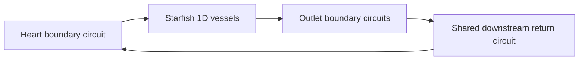

# Closed-loop CRIMSON netlist integration in Starfish

## 1. Objective and status

**Status: proposed implementation; no closed-loop Starfish runtime is introduced
by this document.** Source review date: 2026-10-20.

The objective is to connect Starfish's 1D vessel network to a group of CRIMSON
boundary circuits that share a downstream return circuit. The return circuit
completes the circulation between the arterial outlets and the heart-side
boundary. The implementation will use the **NumPy/reference** netlist-py
backend selected through the existing root `netlist_config.py`.

The expected result is a simulation in which vessel endpoint pressures and
flows, upstream circuit states, and downstream return states satisfy one
consistent boundary coupling calculation at each timestep. Controllers and
valves advance once along the accepted state trajectory. Output includes the
return circuit as well as the vessel and upstream circuit histories.

The work has three parts:

1. Reuse netlist-py's global circuit assembly and interface responses.
2. Introduce a coordinated characteristic boundary solve in Starfish.
3. Establish a C++ reference for the same physical model and coupling schedule.

Existing C++ adapters, worker sources, bindings and integration call sites must
remain available for reference. The previously disabled production C++ calls
remain commented out. Production execution continues to use NumPy/reference.

### Contents

- [Current capability and missing integration](#2-current-capability-and-missing-integration)
- [Physical model, scope and inputs](#3-physical-model-scope-and-inputs)
- [Notation and units](#4-notation-and-units)
- [Circuit equations and global assembly](#5-circuit-equations-and-global-assembly)
- [Interface responses](#6-interface-responses)
- [Coupled Starfish characteristic equations](#7-coupled-starfish-characteristic-equations)
- [Mixed pressure and flow modes](#8-mixed-pressure-and-flow-modes)
- [Worked analytical example](#9-worked-analytical-example)
- [Timestep, valve and controller lifecycle](#10-timestep-valve-and-controller-lifecycle)
- [Proposed software architecture](#11-proposed-software-architecture)
- [Scheduling and boundary refactoring](#12-scheduling-and-boundary-refactoring)
- [Identity mapping and initialization](#13-identity-mapping-and-initialization)
- [C++ reference and comparison strategy](#14-c-reference-and-comparison-strategy)
- [Validation requirements](#15-validation-requirements)
- [Results, provenance and timing](#16-results-provenance-and-timing)
- [Implementation work packages](#17-implementation-work-packages)
- [Risks and completion criteria](#18-risks-and-completion-criteria)
- [Source references](#19-source-references)

## 2. Current capability and missing integration

### 2.1 What is implemented in Starfish

The current path is:

```text
Starfish Netlist boundary
  -> NetlistBoundaryInterface
  -> NetlistBoundaryManager
  -> NetlistPyAdapter
  -> independent reference boundary circuits
```

Each endpoint requests a scalar affine relation, solves its characteristic
equation, and records its pressure and flow. The manager then supplies every
surface's accepted input to the circuit update at the end of the timestep.

The current adapter explicitly rejects a nonempty
`netlist_closed_loop_downstream.xml`. The current characteristic interface also
assumes zero flow when a port is blocked. It does not implement a general
pressure-driven circuit port that returns nonzero flow.

The completed tutorial comparisons exercise independent boundary circuits.
Feedback between a blood-loss observer and a heart controller does not, by
itself, establish a closed hydraulic return path.

### 2.2 What is already available in netlist-py

The reviewed checkout provides:

| Existing capability | Relevant API/module |
| --- | --- |
| Parse downstream circuits and their explicit connections | `NetlistXmlReader.parse_downstream_netlist_circuit_with_controls` |
| Prepare one connected subsection and its initial runtime arrays | `NetlistCase.prepare_closed_loop_subsection` |
| Assemble rectangular local contributions and shared junction equations | `ClosedLoopDownstreamSubsection_reference` |
| Compute full pressure and flow responses between ports | `compute_interface_response`, `compute_closed_loop_diode_interface_response` |
| Accept histories and select next-step diode flags | `finalize_closed_loop_diode_timestep` |
| Resolve owner-local controller observations and targets | Closed-loop observation layout and reference controller manifest APIs |
| Run an upstream standalone closed-loop example | Closed-loop replacement driver and existing C++ oracle checks |

These capabilities support reuse of the circuit mathematics. They do not
automatically integrate the Starfish characteristic boundary equations.

### 2.3 Coupling method proposed here

**Use a simultaneous solve of the connected Starfish endpoint characteristic
unknowns, with circuit state, controller targets and valve modes frozen during
that solve.**

The upstream closed-loop 0D replacement driver preserves a delayed exchange
with separate provisional and published port snapshots. This proposal defines
a different external coupling method for the 1D vessel solver. Its global
circuit equations can be checked against C++; its complete trajectory must be
compared against a C++ circuit backend driven by the same Starfish schedule.
Agreement with a native delayed 0D replacement trajectory is a separate claim.

## 3. Physical model, scope and inputs

### 3.1 Circulation topology



The arrows indicate a typical physiological flow direction. Actual component
flows remain signed and may reverse.

Starfish supplies the 1D vessel domain. A generated 0D replacement of those
vessels is not required in the proposed production path. The upstream generated
replacement remains useful as a separately validated reference experiment.

Closing an existing example requires an explicit return topology and its
physical parameters. Independent prescribed-pressure outlet reservoirs cannot
be assumed to become a return circuit merely by enabling a flag. Retain fixed
reference nodes where the actual component formulation requires them; do not
delete compliance reference nodes indiscriminately.

### 3.2 Initial supported scope

- One downstream subsection with multiple attached upstream boundary circuits.
- Explicit proximal and distal vessel endpoint bindings.
- Physical surface ID 0, nonconsecutive surface IDs and reversed component orientation.
- Constant timestep and `alfi = 1` for the first production milestone.
- The reference implementation's supported R/C/L, volume and chamber equations.
- Automatic diode modes and shared controller scheduling in a later milestone.
- A case-defined source/sink ledger when hemorrhage or another external loss is present.

Additional independent boundary circuits may coexist once mixed scheduling is
validated. Multiple downstream subsections require their own ownership and
scheduling extension; they are outside the first milestone.

### 3.3 Case layout

```text
case/
    input.xml
    netlist_surfaces.xml
    netlist_closed_loop_downstream.xml
    controller_reference.py             if declared
    controller.py                       retained C++ version, if available
    inflow.csv                          only if the physical case declares it
```

The downstream XML declares the upstream surface/node associated with each
shared downstream node. A connection is identified by physical circuit and
node identities, never by a guessed matrix offset.

## 4. Notation and units

| Symbol | Meaning |
| --- | --- |
| `n`, `dt` | Accepted timestep index and physical timestep |
| `h^n` | Accepted circuit histories retained at the start of the step |
| `theta^n` | Runtime R/C/L/E/V0 values and prescribed values used this step |
| `z^n` | Retained diode flags; active interface modes are derived from them |
| `x` | Global circuit solution vector, including current and history columns |
| `A_c`, `f` | Global circuit matrix and RHS contribution independent of external port inputs |
| `u` | Vector of prescribed inputs to the netlist, one per external port |
| `p`, `q` | External port pressures and signed external flows |
| `P_v`, `Q_v` | Starfish pressure and axial flow at a vessel endpoint |
| `sigma_i` | Starfish `flowSign`: `q_i = sigma_i * Q_v,i` |
| `eta_i` | Circuit component orientation: `q_component,i = eta_i * q_i` |
| `R_i` | Starfish's local 2 by 2 characteristic-to-pressure/flow transform |
| `w_i`, `k_i` | Unknown incoming and known outgoing characteristic increments |
| `H_p`, `H_q` | Responses of port pressure and external flow to `u` |

For new Starfish physiological examples, use Pa, m³/s, m³ and seconds. Then
resistance has units Pa·s/m³, compliance m³/Pa, inertance Pa·s²/m³, and chamber
elastance Pa/m³. Archived upstream C++ fixtures retain their original consistent
units and must be labelled accordingly.

The Starfish endpoint sign `sigma` and the circuit orientation sign `eta` have
different responsibilities. The upstream response functions already account
for their circuit orientation. Apply `sigma` at the Starfish interface exactly
once; do not apply `eta` again to an already external-flow response.

## 5. Circuit equations and global assembly

### 5.1 Component equations

For component flow from start node `s` to end node `e`, the resistor equation is

\[
p_s-p_e-Rq=0.
\]

With effective increment \(\Delta t_e\), backward Euler gives the capacitor
and inductor equations

\[
p_s-p_e-p_s^n+p_e^n-\frac{\Delta t_e}{C}q=0,
\]

\[
p_s-p_e-\frac{L}{\Delta t_e}q+\frac{L}{\Delta t_e}q^n=0.
\]

For the existing volume component convention,

\[
V-\Delta t_e q-V^n=0.
\]

A pressure chamber additionally imposes the source's absolute start-node law

\[
\frac{p_s}{E}-V=-V_0,
\qquad p_s=E(V-V_0).
\]

Preserve this implemented law when integrating the library. Replacing it with
a different pressure-difference or transmural law would change the model.
A plain volume tracker has no chamber E/V0 slots.

An open diode uses its resistive equation; a closed diode imposes `q = 0`.
Valve flags are fixed during each solve. Histories enter through explicit
identity equations and are not reset from XML on every step.

### 5.2 Shared junction equations

Keep the pressure unknowns belonging to each owner, then enforce equality at
the shared physical junction:

\[
p_{\mathrm{upstream},j}-p_{\mathrm{downstream},j}=0.
\]

The shared Kirchhoff conservation equation is

\[
\sum_{\text{branches ending at }j}q
-\sum_{\text{branches starting at }j}q=0.
\]

Local KCL rows at deferred shared nodes are handled by the upstream layout
builder. Keeping those rows and adding another independent junction equation
would overconstrain the assembly. Use its canonical deferred-node maps.

### 5.3 Global matrix

Let `x` concatenate the upstream circuit vectors and then the downstream
vector. Each local block can be rectangular. In compact form:

\[
A_c=
\begin{bmatrix}
\operatorname{blockdiag}(A_1,\ldots,A_m,A_d)\\
J_q\\
J_p
\end{bmatrix},
\qquad A_c x=f+B u.
\]

`J_q` contains shared KCL equations, `J_p` pressure equalities, and `B` inserts
the active external prescriptions with the correct orientation signs.
All histories, parameters, modes and the effective increment are held fixed
when writing this affine system.

Necessary row count:

\[
\sum_i r_i+N_{\mathrm{shared\ KCL}}+N_{\mathrm{pressure\ equalities}}
=\sum_i c_i.
\]

A square matrix alone does not prove the model is valid. Contradictory
prescriptions, a missing pressure datum or an invalid closed-valve topology
can still make it singular or inconsistent. The chosen pressure reference and
initial stored volumes must be physically consistent; do not add an arbitrary
ground as a numerical repair.

The upstream original heart fixture provides a useful assembly check:

| Contribution | Rows | Columns |
| --- | ---: | ---: |
| Heart | 14 | 15 |
| First outlet | 8 | 9 |
| Second outlet | 8 | 9 |
| Downstream return | 7 | 9 |
| Shared KCL | 2 | — |
| Pressure equalities | 3 | — |
| Total | 42 | 42 |

This is an existing upstream fixture, not a proposed SI parameter set for the
Starfish tutorial.

## 6. Interface responses

### 6.1 Compute responses without accepting state

Choose a finite baseline input vector \(u_*\) in the frozen modes. Solve

\[
A_c x_*=f+B u_*,\qquad A_c Y=B.
\]

This uses a multiple-RHS solve; no explicit inverse is required. The upstream
implementation constructs unit RHSs at **active prescription equation rows**
and applies its input signs. A flow solution-column index is not an RHS-row
index, particularly after a pressure-mode row permutation.

Let `G_p` select current port pressures and `G_q` select component flows.
With \(S_\eta=\operatorname{diag}(\eta_i)\), external flow is
\(q=S_\eta G_qx\). Thus

\[
H_p=G_pY,\qquad H_q=S_\eta G_qY,
\]

\[
p_0=G_px_*-H_pu_*,\qquad
q_0=S_\eta G_qx_*-H_qu_*.
\]

The resulting port relations are

\[
\boxed{p=p_0+H_pu,\qquad q=q_0+H_qu.}
\]

The upstream APIs return the responses with their orientation transforms
already included. These equations explain their meaning, not another layer
of sign multiplication to add around those APIs.

### 6.2 All ports prescribed by flow

When every port supplies external flow, \(u=q\), so

\[
\boxed{p=p_0+H_pq.}
\]

Off-diagonal entries represent communication through the return circuit.
For example, \((H_p)_{12}\) is the change of pressure at port 1 caused by a
change of flow at port 2 with accepted state and active modes fixed.

### 6.3 Why the scalar Hop is conditional

The C++ scalar coefficient for port `i` has the form

\[
p_i=(H_p)_{ii}q_i+\mathrm{Hop}_i,
\]

\[
\mathrm{Hop}_i=(p_0)_i+\sum_{j\ne i}(H_p)_{ij}(q_*)_j.
\]

Consequently, `Hop_i` generally differs from `(p_0)_i`. A single sweep of
independent endpoint solves using these conditional offsets freezes the other
flows at a snapshot. It is a lagged approximation, not the simultaneous system
derived below. Iterating it would require convergence and failure criteria.

The proposed first implementation uses the direct small endpoint system and
retains conditional scalar getters only for reference checks.

## 7. Coupled Starfish characteristic equations

### 7.0 Relation to the 1D vessel equations

For orientation, a standard form of the incompressible 1D vessel equations is

\[
\frac{\partial A}{\partial t}+\frac{\partial Q_v}{\partial z}=0,
\]

\[
\frac{\partial Q_v}{\partial t}
+\frac{\partial}{\partial z}\left(\alpha_m\frac{Q_v^2}{A}\right)
+\frac{A}{\rho}\frac{\partial p}{\partial z}
=f_{\mathrm{friction}}+Ag_z,
\qquad p=\mathcal{P}(A,z).
\]

Here `alpha_m` is the momentum-profile coefficient, not the netlist timestep
parameter `alfi`. The configured wall law and fluid model determine the local
wave speeds and characteristic transform. This notation describes the vessel
model; this integration does not replace the existing field discretization or
select a new wall law.

At a subcritical external endpoint, the vessel interior supplies one outgoing
characteristic and the boundary condition determines the incoming one. The
coupled circuit relation supplies those missing endpoint equations for the
whole group. If a case leaves the one-incoming-characteristic regime, this
boundary construction requires a separate characteristic-count review.

### 7.1 Endpoint packet

The current Starfish boundary update satisfies

\[
\begin{bmatrix}\Delta P_{v,i}\\\Delta Q_{v,i}\end{bmatrix}
=R_i\begin{bmatrix}\omega_{i,0}\\\omega_{i,1}\end{bmatrix}.
\]

At a proximal endpoint, index 0 is unknown and index 1 is known. At a distal
endpoint, index 1 is unknown and index 0 is known. Let `j` denote the unknown
column and `l` the known column. Define

\[
a_i=P^n_{v,i}+(R_i)_{0l}k_i,\qquad b_i=(R_i)_{0j},
\]

\[
c_i=\sigma_i\left(Q^n_{v,i}+(R_i)_{1l}k_i\right),
\qquad d_i=\sigma_i(R_i)_{1j}.
\]

Then, in external circuit-flow coordinates,

\[
p_i=a_i+b_iw_i,\qquad q_i=c_i+d_iw_i.
\]

Stacking the endpoints gives

\[
p=a+D_pw,\qquad q=c+D_qw,
\]

where \(D_p=\operatorname{diag}(b_i)\) and
\(D_q=\operatorname{diag}(d_i)\).

### 7.2 Simultaneous flow-driven solve

Substitute the characteristic relations into the circuit pressure response:

\[
a+D_pw=p_0+H_p(c+D_qw).
\]

Therefore solve

\[
\boxed{(D_p-H_pD_q)w=p_0+H_pc-a.}
\]

For `m` connected ports, this is an `m` by `m` dense system. Reconstruct all
endpoint pressures and flows from the same solution `w`. Reconstruct each
two-entry characteristic vector with its original known component; preserve
the existing boundary flow bookkeeping and vessel pressure-to-area law.

For one independent port this reduces exactly to the existing scalar Robin
characteristic equation, including the proximal/distal column selection and
Starfish `flowSign`. That reduction is a required regression check.

### 7.3 Alternative flow-coordinate expression

If every \(d_i\ne0\), define

\[
Z_c=D_pD_q^{-1},\qquad g=a-Z_cc.
\]

Then \(p=g+Z_cq\), and

\[
(Z_c-H_p)q=p_0-g.
\]

This is useful for analysis. The characteristic-unknown form avoids requiring
division by each `d_i` and directly matches the current boundary API.

## 8. Mixed pressure and flow modes

### 8.1 Mode convention

| Port condition | Quantity prescribed to netlist | Conjugate quantity returned |
| --- | --- | --- |
| Flow permitted | External flow | Pressure |
| Pressure-driven mode | External pressure | External flow |

A closed diode may lead to a zero-flow condition, but a general pressure-driven
port need not return zero flow. Use its actual response.

Let `F` be a diagonal selector with entry 1 for a flow-input port and 0 for a
pressure-input port. Let \(T=I-F\). Then

\[
u=Fq+Tp.
\]

This vector has a declared quantity and unit per position. It is not a uniform
flow vector, and `H_p` is not uniformly a resistance matrix in this case.

Substituting the characteristic relations gives

\[
u=u_c+D_uw,\qquad u_c=Fc+Ta,\qquad D_u=FD_q+TD_p.
\]

### 8.2 Enforce the returned quantity at every endpoint

At flow-input ports enforce the returned pressure; at pressure-input ports
enforce the returned flow:

\[
F\left[p-p_0-H_pu\right]
+T\left[q-q_0-H_qu\right]=0.
\]

The simultaneous boundary system is

\[
\boxed{K_w w=r_w.}
\]

\[
K_w=F(D_p-H_pD_u)+T(D_q-H_qD_u),
\]

\[
r_w=F(p_0+H_pu_c-a)+T(q_0+H_qu_c-c).
\]

Setting `F = I` recovers the all-flow system. A genuinely blocked port with
identically zero returned flow gives the expected zero-flow characteristic
condition. This handles that special case without assuming every pressure
mode is blocked.

### 8.3 Independent monolithic equation check

For validation, the same endpoint result can be obtained without eliminating
the circuit unknowns:

\[
\begin{bmatrix}
A_c & -BD_u\\
FG_p+TG_q^{ext} & -(FD_p+TD_q)
\end{bmatrix}
\begin{bmatrix}x\\w\end{bmatrix}
=
\begin{bmatrix}
f+Bu_c\\Fa+Tc
\end{bmatrix},
\]

where \(G_q^{ext}=S_\eta G_q\). Compare this direct system against the
response-based endpoint solve on small fixtures. It provides an independent
check of elimination, signs, offsets and mixed-mode selection.

### 8.4 Scaling and conditioning

Mixed rows constrain pressures or flows, and characteristic normalization can
also vary. Use explicit positive row and unknown scales:

\[
(W_rK_wW_c)y=W_rr_w,\qquad w=W_cy.
\]

Scaling changes numerical representation, not the physical equations. Record
the selected physical scales, scaled residual and condition estimate. Reject
singular or nonfinite solves. Do not repair them by adding diagonal leakage,
clamping pressures, changing R/C/L values or dropping junction equations.

## 9. Worked analytical example

Use a two-port resistive fixture in internally consistent arbitrary units:
proximal resistances 2 and 4, a shared distal resistance 8, and reservoir
pressure 3. This is an analytical coupling fixture, not a complete heart model.

The common pressure and port pressures are

\[
p_d=3+8(q_1+q_2),\quad p_1=p_d+2q_1,\quad p_2=p_d+4q_2.
\]

Thus

\[
H_p=\begin{bmatrix}10&8\\8&12\end{bmatrix},\qquad
p_0=\begin{bmatrix}3\\3\end{bmatrix}.
\]

At prescribed flows `(1, 2)`, pressures are `(29, 35)`. The conditional scalar
pairs are `(dp_dq, Hop) = (10, 19)` and `(12, 11)`. This immediately exposes
confusion between the vector offset and the conditional Hop.

Now give the vessel characteristics

\[
p_1=29-q_1,\qquad p_2=35-2q_2.
\]

The coupled endpoint equations become

\[
\begin{bmatrix}11&8\\8&14\end{bmatrix}
\begin{bmatrix}q_1\\q_2\end{bmatrix}
=\begin{bmatrix}26\\32\end{bmatrix}.
\]

Their exact solution is

\[
q_1=1.2,\quad q_2=1.6,\quad p_d=25.4,
\quad p_1=27.8,\quad p_2=31.8.
\]

Required checks include these values, both off-diagonal responses, invariance
under a consistent port permutation, and equivalence to the monolithic solve.

## 10. Timestep, valve and controller lifecycle

### 10.1 Accepted state

Retain an explicit accepted state containing:

```text
accepted timestep index
accepted circuit histories
published current pressure/flow/volume observations
diode flags
controller state
runtime target arrays
last accepted external port pressure/flow vectors
```

A coefficient probe or endpoint trial must not change this state. In the
reference path, protect accepted arrays from mutation through shared views.

### 10.2 Proposed Starfish schedule

For the initial `alfi = 1` profile:

1. Retain `h^n`, `theta^n`, controller state and diode flags.
2. Derive local interface reachability/modes from the retained valve flags.
3. Gather every connected vessel's characteristic packet from timestep `n`.
4. Assemble the full-dt subsection and compute its port response at fixed state.
5. Solve the simultaneous characteristic system for all connected endpoints.
6. Solve the circuit at the resulting active port inputs with full `dt`.
   Check that its returned conjugate quantities match the endpoint solution.
7. Validate all proposed endpoint pressures, flows and areas, then scatter the
   endpoint values into Starfish's timestep `n+1` storage.
8. Run the existing vessel/interior and connection operations in their audited
   order. Retain the circuit candidate without accepting it during these calls.
9. After all required operations succeed, publish physical circuit values and
   accept circuit histories once. Determine next-step diode flags.
10. Update one shared controller schedule from the accepted physical observations
    and prepare targets for the following timestep.
11. Publish accepted output before runtime memory advances or flushes that step.

The last point requires an explicit scheduling seam: network output and runtime
memory management are currently entries in `numericalObjects`. Separate their
publication/rollover role from the numerical phase so they cannot run ahead of
closed-loop finalization. Preserve existing independent-case behavior.

All endpoint solves use one frozen packet set. A later endpoint cannot see an
earlier endpoint's newly accepted circuit history. Do not advance a controller
again during unit-response calculation or final circuit reassembly.

### 10.3 Valve behavior

Reuse the source's local reachability and next-step diode predicate:

\[
\mathrm{open}^{n+1}=
(p_s-p_e\ge-10^{-8})\;\lor\;(q\ge10^{-8}).
\]

These are literal legacy predicate thresholds in the case's units. They are
not the proposed trajectory comparison tolerances. Preserve the kernel's
published-state and history acceptance sequence.

Do not introduce same-step valve iteration as part of boundary coupling.
The boundary system is simultaneous at fixed active valve flags; next-step
mode selection remains a separate operation. Upstream reachability is local
to each boundary circuit, not a walk through the whole return network.

### 10.4 Controller phase and ownership

The existing Starfish adapter updates controllers after circuit acceptance.
Retain that phase for the proposed first Starfish closed-loop profile and
implement the same phase in its C++ comparison harness.

The upstream `controlled_closed_loop_iter_init` updates controllers before
the solve using old published observations. Calling that driver entry point
directly would change the Starfish schedule. Reuse lower-level assembly,
observation and controller APIs with explicit orchestration instead.

Use one schedule spanning upstream and downstream owners:

- Gather physical current pressure/flow/volume columns for the correct owner.
- Execute modern Python controllers by ascending priority.
- Start each controller update with a fresh broadcast dictionary.
- Expose only earlier controllers' broadcasts and merge with first-writer-wins semantics.
- Execute the supported built-in group in its documented order.
- Apply targets to explicit owner/kind/physical-ID/runtime-slot bindings.

Initialize built-in targets at time zero according to their source semantics.
Setup validation must discard sampled updates and must not advance physical
time or retained controller state. Conflicting destinations are rejected until
an explicit ordered-write contract is implemented.

### 10.5 Failure handling and alpha

A failed probe, missing endpoint, stale packet or incomplete circuit candidate
must not accept history or increment counters. Prepare reference-side next
state and controller results before retaining a successful transition where
the APIs permit this. A failure after an external C++ harness has committed
state must mark the run failed; do not promise rollback or retry it as though
the old state were still current.

First implement and validate `alfi = 1`. A future alpha-stage extension must
define how Starfish supplies stage-compatible characteristics and endpoint
states. Independent `alpha*dt` probes, full-dt updates and the upstream
replacement driver's first-query cache semantics are different contracts.
Do not infer generalized-alpha support from the presence of an `alfi` argument.

## 11. Proposed software architecture

### 11.1 Responsibilities and files

The following names for new modules and APIs are proposals.

| File | Proposed responsibility |
| --- | --- |
| `netlist_config.py` | Keep the existing netlist-py location and reference backend policy |
| `UtilityLib/netlistClosedLoopPyAdapter.py` (new) | Parse/setup one subsection; own accepted circuit state, response queries, candidates, controllers and downstream histories |
| `NetworkLib/netlistCoupling.py` (new) | Pure NumPy characteristic packet algebra, all-flow/mixed endpoint systems, reconstruction and residual checks |
| `NetworkLib/netlistManager.py` | Explicit bindings, topology-based adapter selection, group coordination and one finalization |
| `NetworkLib/netlistInterface.py` | Preserve scalar path; expose packet/reconstruction helpers for grouped endpoints |
| `SolverLib/classBoundarys.py` | Separate preparation, validation and application of a boundary result |
| `SolverLib/class1DflowSolver.py` | Insert the group operation and separate numerical stepping from output/memory rollover |
| `NetworkLib/classVascularNetwork.py` | Audit initialization paths that currently assume independent terminal resistance |
| `UnitTesting/` | Analytical, lifecycle, integration and backend comparison checks added during implementation |
| New C++ validation sources under `ext/` | Closed-loop reference harness alongside the preserved existing worker |

The current `NetlistPyAdapter` remains the independent-circuit path. Adapter
selection is based on validated topology, not a user-selectable production
backend. A malformed downstream file raises an error rather than silently
selecting independent circuits.

### 11.2 Proposed data contracts

```python
# Schematic records: field names describe the contract, not implemented APIs.
PortBinding(
    physical_surface_id, vessel_id, endpoint_position, flow_sign,
    xml_circuit_index, internal_surface_id, port_position,
)

CharacteristicPacket(
    binding, timestep, memory_generation, dt,
    current_pressure, current_axial_flow, current_area,
    characteristic_matrix, known_increment,
    unknown_column, known_column,
)

PortResponse(
    source_state_version, timestep, effective_dt, active_modes, flow_input_mask,
    pressure_response, flow_response, pressure_offset, flow_offset,
)

BoundaryCandidate(
    source_state_version, port_order, active_inputs,
    pressures, external_flows, characteristic_increments,
    circuit_candidate, residuals,
)
```

Packets must own copies of any matrices or arrays that the system-equation
object reuses. This matters when both ends of one vessel are in the group.
The candidate must carry enough source-state identity to reject stale probes.
The response's Boolean `flow_input_mask` is derived from, and validated against,
its active modes. It is not an independent caller-selected mode override.

### 11.3 Proposed adapter operations

```python
load(bindings, dt, case_directory)
begin_step(timestep, time, dt)
probe_port_response(flow_snapshot, pressure_snapshot)
solve_trial(active_inputs)
prepare_acceptance(boundary_candidate)
finalize_prepared_step(prepared_transition)
close()
```

`probe_port_response` and `solve_trial` are observational with respect to
accepted state. The adapter derives modes from its retained circuit state;
callers cannot invent a contradictory mode vector. `prepare_acceptance`
validates complete endpoint coverage, timestep identity, physical publication,
history and controller transitions. Finalization retains one completed step.

Freeze the mapping and group membership before stepping. Logging and output
use physical identities; internal positive IDs remain implementation details.

### 11.4 Boundary algebra pseudocode

The following sketch implements the equations in sections 7–8. Helpers,
records, scaling selection and error handling are proposed interfaces.

```python
def solve_group(packets, response, physical_scales):
    # Each packet is frozen at the same timestep and memory generation.
    a, b, c, d = characteristic_coefficients(packets)
    Dp, Dq = np.diag(b), np.diag(d)
    F = np.diag(response.flow_input_mask.astype(np.float64))
    T = np.eye(len(packets)) - F

    Hp = response.pressure_response
    Hq = response.flow_response
    p0 = response.pressure_offset
    q0 = response.flow_offset

    uc = F @ c + T @ a
    Du = F @ Dq + T @ Dp
    matrix = F @ (Dp - Hp @ Du) + T @ (Dq - Hq @ Du)
    rhs = F @ (p0 + Hp @ uc - a) + T @ (q0 + Hq @ uc - c)
    w = solve_scaled_system(matrix, rhs, physical_scales)

    pressure = a + Dp @ w
    external_flow = c + Dq @ w
    active_inputs = F @ external_flow + T @ pressure
    check_response_residuals(pressure, external_flow, active_inputs, response)
    return reconstruct_boundary_candidate(packets, w, active_inputs)
```

The group coordinator next calls the circuit adapter's full-dt `solve_trial`
using these inputs and validates its actual physical publication before
applying endpoint values. Neither this algebra nor that trial accepts state.
Acceptance occurs at the explicit finalization seam after the numerical phase
succeeds. The reconstruction helper retains physical flow signs, both known
and unknown characteristic entries, and each boundary's existing bookkeeping.

## 12. Scheduling and boundary refactoring

### 12.1 Existing dependency

The current numerical object list interleaves the root boundary, vessel
fields, connections and terminal boundaries. A boundary call both calculates
its characteristic input and writes endpoint arrays immediately. Group
coupling requires gathering all connected endpoint packets before applying
their results.

Moving callbacks without auditing array access would risk mixing timestep
`n` and `n+1` data. Runtime memory rollover is another dependency: array index
`nmem` is not always the global timestep number.

### 12.2 Refactoring sequence

1. Extract a preparation operation that computes the exact existing
   `updateLARL` inputs and known characteristic from current timestep arrays.
2. Extract validation/application of `dP`, `dQ`, area and blood-flow bookkeeping.
3. Keep the ordinary boundary call as preparation → scalar solve → application.
   Establish equivalence for existing cases before adding grouping.
4. Add a grouped boundary object that gathers packets, solves once, validates
   every result and applies each member exactly once.
5. Schedule that group before any operation consuming its next-step endpoints.
   The reviewed field implementations read timestep `n` and write interior
   timestep `n+1` cells; confirm this for every activated solver variant.
6. Replace only the grouped members' individual scheduled calls. Preserve
   other field, connection and native-boundary ordering where compatible.
7. Finalize the netlist after the numerical phase succeeds, before accepted
   output and memory rollover. Audit normal and cycle execution paths.

For the initial supported scheme, gather all group packets from timestep `n`
and place the group before field advancement. If another scheme needs
predicted data, introduce an explicit stage interface before enabling it.

The first milestone must either support a given alternate execution path or
reject it at setup with a specific reason. A second hidden, unsynchronized
boundary update in cycle mode is not acceptable.

## 13. Identity mapping and initialization

### 13.1 Physical surface 0

The current Starfish adapter accepts surface 0. The reviewed upstream
downstream parser and subsection setup require positive surface IDs.

Use an explicit bijection, for example:

| Physical surface | XML circuit index | Internal positive surface | Port position |
| ---: | ---: | ---: | ---: |
| 0 | 1 | 1 | 0 |
| 4 | 2 | 2 | 1 |
| 12 | 3 | 3 | 2 |

This example preserves the existing sorted-surface-to-XML mapping, then
records every association. Runtime code gathers and scatters using that table;
it must not independently sort vessels, circuits or return connections.

Because the upstream parser reads paths and validates connection surface IDs,
normalize downstream surface references in a private XML copy before calling
it. Rewrite only the mapped upstream surface IDs. Preserve node IDs, circuit
indices, physical parameters, declaration order and original XML files.
Reject connections to unknown surfaces.

Persist original and normalized XML with the mapping and their hashes. Resolve
controller modules through an explicit original/snapshotted case directory;
normalizing XML in another directory must not change script discovery.
Owner labels and output filenames are translated back to physical identities.

### 13.2 Vessel and circuit initialization

Current network initialization includes cumulative terminal resistance and
proximal-Netlist heuristics. A shared downstream circuit changes those
assumptions. Reusing independent-terminal resistance splitting could produce
inconsistent initial flows even when the timestep equations are correct.

For the first fixture, use an explicitly documented initial pressure/flow
profile and matching circuit histories/volumes. Audit the existing
`ConstantPressure` path and its remaining resistance-dependent setup before
using it. Reject incompatible automatic initialization rather than silently
applying an open-terminal estimate.

Document any intentional initial pressure jump and its resulting startup
transient. Do not reset chamber volume to eliminate a transient after a run
has started. A future equilibrium initializer can solve the coupled steady
equations with the same constraints and a stated heart phase; it is a
separate feature from a functioning timestep coupling.

The existing boundary callback rejects negative calculated vessel pressure.
The initial supported case must fit that pressure convention. A physiological
model needing negative gauge pressures requires an explicit review of the
vessel wall law and pressure checks; the closed-loop adapter must not hide it
by clipping or shifting pressures independently of the circuit.

## 14. C++ reference and comparison strategy

### 14.1 Current worker limitation

The retained `CrimsonNetlistRuntime::createSurface` creates independent
`NetlistCircuit` instances. It does not build the shared downstream subsection.
Merely running that worker next to a downstream XML file would not provide a
closed-loop C++ reference.

Add separate validation code that uses the source's
`NetlistBoundaryCircuitWhenDownstreamCircuitsExist`,
`NetlistClosedLoopDownstreamCircuit` and `ClosedLoopDownstreamSubsection`
responsibilities. Review their ownership and initialization APIs before
designing the harness. Preserve the current worker and its behavior.

### 14.2 Three levels of comparison

**A. Circuit equation and prescribed-port comparison.** Supply identical
explicit pressure/flow vectors, parameters, timestep, histories and modes to
the C++ and NumPy subsections. Compare assembled equations, current solutions,
conditional scalar getters and accepted trajectories. Frozen-state unit
responses must not accidentally advance or reuse a stale C++ cached solve.
Where necessary, expose native assembled matrices or an explicit cache-reset
validation seam. A NumPy calculation labelled as C++ output is not evidence.

**B. Same Starfish coupling algorithm, different circuit backend.** Drive the
proposed simultaneous endpoint solver with each backend's independently
computed response. Both runs own their own state, controllers and trajectories.
Use the same post-acceptance controller phase and output sampling. This is
the required full Starfish C++ versus NumPy integration comparison.

**C. Native upstream delayed replacement trajectory.** Retain the existing
upstream original-heart/BCT oracle checks as evidence for that profile.
They use a generated 0D domain and its source exchange schedule. Differences
between that model and a 1D Starfish vessel domain are not backend errors.

Levels A and B are required for this integration. Existing level C evidence
does not replace either one.

## 15. Validation requirements

This section specifies future implementation checks. No new tests or solver
runs were performed to author this planning document.

### 15.1 Analytical and algebraic gates

- The two-port example in section 9, including conditional Hop values.
- One-port and diagonal-response reduction to the existing scalar solver.
- Mixed pressure/flow reduction, including nonzero returned flow.
- Response elimination versus the independently assembled monolithic system.
- Explicit surface 0 and nonconsecutive surface mappings.
- Proximal/distal bindings and reversed circuit component orientation.
- Invariance under consistent permutations of port order and declaration order.
- Shared KCL, pressure equality and block row/column count checks.
- Diagnostic failures for singular topology and contradictory prescriptions.

Check the global linear backward error in scaled coordinates:

\[
\rho_A=\frac{\|A_cx-b\|_\infty}
{\|A_c\|_\infty\|x\|_\infty+\|b\|_\infty}.
\]

Handle an exactly zero denominator explicitly. Apply the same form to the
endpoint system. Because equation rows have different units, use stated row
and variable scaling before forming a norm across the whole matrix. Also
report physical-unit residuals for individual KCL and equality constraints.

### 15.2 Lifecycle gates

- Repeated probes leave histories, flags, targets and controller counters unchanged.
- Exactly one state for every connected endpoint is required for acceptance.
- Duplicate, stale, nonfinite and cross-timestep packets are rejected.
- New histories come from current published columns, not old-history columns.
- Downstream and upstream histories advance together.
- Closed/open diode flags and interface mode sequences match the reference.
- Owner-local observations and cross-owner progressive broadcasts are correct.
- Controller setup samples do not become runtime updates.
- Both ends of one vessel work without shared-matrix view corruption.
- Memory rollover, output cadence and cleanup preserve step/row alignment.
- An incomplete failed timestep adds no accepted output row.

### 15.3 Physical conservation

At each shared junction report

\[
r_{q,j}=\sum q_{\mathrm{ending}}-\sum q_{\mathrm{starting}},
\qquad r_{p,j}=p_{\mathrm{upstream},j}-p_{\mathrm{downstream},j}.
\]

For the 1D domain, compute vessel volume from the declared spatial quadrature
of `A`. For a declared closed system with no physical source or loss,

\[
V_{\mathrm{total}}^{n+1}-V_{\mathrm{total}}^n
=\epsilon_{\mathrm{discretization}}.
\]

For an explicitly declared loss/source model, use

\[
\Delta V_{\mathrm{total}}
=\int_{t_n}^{t_{n+1}}(Q_{\mathrm{source}}-Q_{\mathrm{loss}})\,dt
+\epsilon_{\mathrm{discretization}}.
\]

Construct the 0D storage ledger from the actual model: chamber volumes and
declared compliance storage must be counted once. An electrical reference
node is not automatically an external blood-loss outlet. Do not infer a loss
from every grounded component.

Starfish's vessel discretization need not conserve the quadrature-derived
volume to machine precision. Report the defect and verify its resolution
dependence; distinguish it from an algebraic shared-junction residual.

### 15.4 Trajectory comparisons and tolerances

Compare every accepted upstream/downstream pressure, flow and volume column,
every saved vessel P/Q/A dataset, time arrays, step counts and mode sequence.
Record controller outputs/state diagnostics at an identical phase.

For SI cases, the current independent-backend thresholds are a starting
proposal: `rtol = 5e-11`, pressure `atol = 1e-8 Pa`, flow `1e-12 m³/s`, volume
`1e-12 m³`, and area `1e-14 m²`. These thresholds have not been demonstrated
for the proposed Starfish closed-loop integration.

Retain the upstream original-unit fixture's reviewed error budget when using
its archived evidence. Do not relabel native-unit errors as SI errors or relax
thresholds simply to obtain a pass. If a gate fails, identify the first
divergent equation, history, controller update or valve event before reviewing
whether its numerical budget is appropriate.

Use timestep refinement with the same underlying physical input/controller
law and compare event times in physical time. Existing 0.5-second upstream
evidence is not a long-duration settling result. Longer physiological and
hemorrhage runs belong after the short deterministic gates pass.

The vessel CFL restriction remains necessary, but it alone does not establish
stability of the combined circuit, wall and controller system. Exercise stiff
return compliances, high resistance contrasts and the documented control gains
at several timestep sizes. Backward Euler circuit history is first order;
the second-order form of an interior MacCormack update does not, by itself,
make the complete coupled trajectory second order. Report observed convergence
rather than assigning an order from one subsystem's scheme name.

### 15.5 Required fixtures

| Fixture | Main purpose |
| --- | --- |
| Two-port passive shared resistance | Off-diagonal response and exact endpoint solve |
| Shared RC return | History carry and reservoir storage |
| R/L/volume variant | Flow history and volume-column ownership |
| Surface 0, nonconsecutive IDs, reversed interface | Identity and orientation |
| One pressure-input port with nonzero returned flow | General mixed-mode boundary equation |
| Original upstream heart/return fixture | Native C++ assembly, getters and carried state |
| Small explicit Starfish vessel/return case | End-to-end simultaneous coupling |
| Heart/valve case | Valve events and chamber publication |
| Downstream observer and upstream feedback | Global controller schedule and ownership |
| Closed circulation with declared bleed | Total-volume loss ledger |

Repeat the existing independent-circuit and tutorial comparisons as regression
gates during implementation. Their previous success does not prove new
closed-loop behavior.

## 16. Results, provenance and timing

Follow the existing per-case comparison layout, with separate backend output
directories and a fresh numbered directory for each execution:

```text
case/results_netlist_comparison/main_001/
    comparison.md
    comparison.json
    cpp/
        inputs/                         original and normalized inputs
        run.json
        console.log
        SolutionData_001/
    python/
        inputs/
        run.json
        console.log
        SolutionData_001/
```

Add downstream files using a documented index convention. The source's first
downstream XML circuit is 1-based, while its history label is typically
`downstreamCircuit_0`. Record that mapping explicitly rather than guessing
from the filename. Physical surface 0 remains `surface_0`.

Save bindings, port order, normalization hashes, case units, controller phase,
backend/code identity, dt/alpha, physical scales, accepted counts and validation
thresholds. Preserve originals and existing results.

Report initialization, complete solve, circuit assembly/response work, endpoint
solve, controller work, output and whole-process time. Use sequential fresh
processes with the same thread settings. Label single-run observations and
any diagnostic-I/O differences. Matrix snapshots or detailed per-step traces
should be optional diagnostics, not always-on benchmark overhead.

First use clear dense solves. Reuse a factorization only after correctness is
established, with an invalidation key covering accepted state dependencies,
effective dt, topology, active mode rows and runtime parameter changes. RHS
changes and matrix changes have different reuse requirements. Never cache a
response across an unexamined controller or valve change.

## 17. Implementation work packages

| Package | Main work | Completion evidence | Depends on |
| --- | --- | --- | --- |
| P0: Freeze contracts | Select the simultaneous `alfi=1` profile, post-acceptance controls, supported field scheme, initialization and output indexing | Written contracts and reproducible small physical fixture | This plan |
| P1: C++ subsection reference | Add a separate native closed-loop harness, input snapshots and matrix/getter/trajectory capture | Real C++ execution with complete provenance and no production backend change | P0 |
| P2: Reference subsection adapter | Parse normalized topology, map surface 0, prepare global state and expose observational responses | Prescribed-port C++/NumPy comparisons; complete downstream histories | P0, P1 for comparison |
| P3: Boundary algebra | Implement packet reconstruction and all-flow/mixed simultaneous systems | Analytical answers, scalar reductions, permutation and monolithic checks | P0 |
| P4: Starfish scheduling | Refactor prepare/apply, insert one group, audit initialization, finalization and memory rollover | Small passive full 1D case; native/independent regressions; no traversal-order dependence | P2, P3 |
| P5: Valves and controllers | Add retained valve modes, downstream ownership, publication and shared control phase | Event sequences, nonzero mixed-mode flow, controller/state checks against matched C++ schedule | P4 |
| P6: Physiological cases | Define return parameters and initial volume; add heart and declared bleed scenarios | Full physical histories, conservation/refinement reports, accuracy and timing | P5 |
| P7: Documentation and optimization | Document case authoring and proven limits; profile before introducing reuse | Reproduction commands and recorded correctness after each optimization | P4–P6 |

P1–P3 can be developed independently where their inputs are already fixed.
The first complete milestone is P4 with a passive return circuit. A tutorial
heart conversion should follow that milestone, rather than being the first
place to diagnose assembly, endpoint algebra and controller timing together.

## 18. Risks and completion criteria

### 18.1 Main risks

| Risk | Consequence | Required response |
| --- | --- | --- |
| Conditional Hop treated as global offset | Missing cross-port effects | Use full response and exact analytical fixture |
| Starfish sign mixed with component orientation | Reversed return flow or incorrect pressure slope | Separate `sigma` and `eta`; test proximal and reversed ports |
| Surface ID used as array position | Wrong endpoint/circuit updates | Persist and validate explicit bindings |
| Boundary calls advance state during gathering | Traversal-dependent result | Observational packets/responses and one acceptance |
| Upstream driver imported with its control phase | Different heart/feedback trajectory | Explicit Starfish orchestration and matched C++ schedule |
| Output/memory runs before netlist acceptance | Misaligned rows or incomplete accepted output | Explicit numerical/finalization/publication phases |
| Automatic initialization assumes terminal grounds | Incorrect initial flow distribution | Explicit first-fixture initialization and audited setup |
| New mode rows use old history indices | Incorrect RHS after valve switch | Use candidate active row maps |
| Ill-conditioned system hidden by clipping | Changed physical model | Scaled residuals and explicit failure |
| Claimed C++ closed-loop run uses the old worker | Invalid backend comparison | Native subsection harness and provenance |

### 18.2 Definition of complete

The first production closed-loop feature is complete when:

1. A documented case loads an explicit shared return circuit and runs through
   the selected Starfish field scheme with NumPy/reference.
2. All connected endpoints satisfy the simultaneous characteristic/circuit
   equations, including tested pressure-input modes.
3. Histories, controllers and valve flags advance in the stated order once
   per accepted step, including across runtime memory rollover.
4. Surface 0, nonconsecutive surfaces and reversed component orientation work
   through the recorded mapping without modifying original physical inputs.
5. Independent analytical, monolithic, native C++ circuit and matched-schedule
   Starfish backend gates pass with reported physical-unit tolerances.
6. Shared-junction residuals and the case-specific volume ledger are reported.
7. Existing independent examples continue to pass, old C++ integration files
   remain available, and per-case output includes accuracy and timing notes.

Multiple return subsections, additional time-integration profiles and a general
equilibrium initializer are subsequent extensions. JAX execution, restart
continuation and migration of the upstream generated replacement domain are
not required for this NumPy Starfish integration milestone.

## 19. Source references

The equations and source findings above were checked against local code. New
module names, data records, scheduling changes and work packages are proposed.

### Starfish

- [Current NumPy integration and limits](netlist_py_integration.md).
- [Reference adapter](../UtilityLib/netlistPyAdapter.py): downstream rejection,
  independent probes, physical publication and post-acceptance controllers.
- [Boundary manager](../NetworkLib/netlistManager.py): registrations, buffered
  endpoint states, factory and finalization.
- [Characteristic interface](../NetworkLib/netlistInterface.py): scalar Robin
  and zero-flow equations, proximal/distal column selection and flow signs.
- [Boundary callback](../SolverLib/classBoundarys.py): preparation and direct
  writes of endpoint pressure, flow, area and flow bookkeeping.
- [Flow solver](../SolverLib/class1DflowSolver.py): numerical object ordering,
  start/finalize hooks and alternate execution paths.
- [Vessel fields](../SolverLib/classFields.py) and
  [network initialization](../NetworkLib/classVascularNetwork.py).
- [Retained C++ runtime](../ext/CrimsonNetlistRuntime.cpp): independent circuit
  creation and current controller lifecycle.
- [Example comparison runner](../UnitTesting/run_example_netlist_comparisons.py).

### Configured netlist-py checkout

Resolve these paths relative to `NETLIST_PY_DIRECTORY`; the location currently
points to `~/crimson/cfs_reg/CRIMSONFlowsolver/flowsolver/netlist_py`.

- `docs/closed_loop_lifecycle.md`: current global equations, state ownership,
  mode rows, responses, controller lifecycle, original replacement exchange,
  C++ evidence and supported limits.
- `src/NetlistXmlReader.py`: downstream connectivity validation and parsing.
- `src/NetlistCase.py::prepare_closed_loop_subsection`: positive surface-ID
  requirement, deferred KCL maps, initial arrays and reference assembly callback.
- `src/ClosedLoopDownstreamSubsection.py`: topology, history, observation and
  port layout records.
- `src/ClosedLoopDownstreamSubsection_reference.py`: global assembly, response
  solves, physical publication, state acceptance and next-step diode predicate.
- `src/pureZeroDDriver_reference.py`: pre-solve controlled initialization and
  the separate delayed replacement exchange profile.
- `tests/test_closed_loop_production_setup.py`,
  `tests/test_closed_loop_interface_response.py`,
  `tests/test_closed_loop_diode_modes.py`, and
  `tests/test_closed_loop_autonomous_trajectory.py`: reusable upstream evidence.
- `tests/fixtures/closed_loop_heart/` and `tests/fixtures/closed_loop_bct/`:
  original-unit topology and the bounded autonomous C++ reference experiment.
