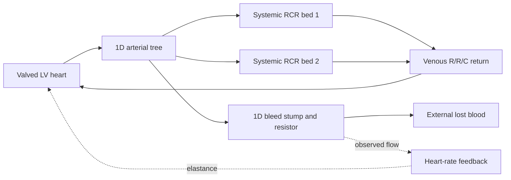

# 1D closed-loop blood-loss heart case

The builder creates a separate runnable example under
`examples/closed_loop_blood_loss_heart/`:

```bash
python3 -B UnitTesting/build_closed_loop_heart.py
python3 -B UnitTesting/run_closed_loop_heart.py
```

The builder refuses to replace an existing case. The runner always allocates a
fresh `results_closed_loop/run_NNN/` directory. `--duration 1` overrides only a
private run copy for a pilot; the created case defaults to the requested 60 s.
Prepared SI XML and all controller files are also kept in this tracked directory.
They can be copied into a new examples directory without rederiving the inputs.

## Model and provenance

The vessel tree, geometry, fluid, CFL=0.1, SI valve/chamber parameters and
blood-loss feedback law come from `examples/cr_sf_tutorial_demo/heart_model/`.
The return circuit topology and parameters come from the supplied
`netlist_py/tests/05-HeartModel-ClosedLoop/2.SimFiles-Benchmark/` example.
The latter is a pure 0D source; its generated replacement domain is not used.
The original example files in both repositories remain untouched.



The circulation recirculates, with an intentional external hemorrhage path.
The bleed outlet must stay independent of the venous return. The adapter uses
the upstream opt-in square-block support for that independent circuit, while
all boundary characteristics and controllers share the same timestep.

| Physical surface | 1D endpoint | Netlist | Return connection |
| --- | --- | --- | --- |
| 0 | Vessel 1 proximal, flowSign=-1 | LV heart | Heart node 6 to downstream node 3 |
| 1 | Vessel 2 distal | RCR bed | Bed node 4 to downstream node 1 |
| 2 | Vessel 4 distal | RCR bed | Bed node 4 to downstream node 1 |
| 3 | Vessel 5 distal | Bleed resistor | None; fixed-pressure external sink |

All computation uses Pa, m³/s, m³ and seconds. The source return circuit used
Pa and mm³: R is multiplied by 1e9 and C by 1e-9. Its SI values are
R1=1.5e7 Pa·s/m³, R2=1e6 Pa·s/m³, C=2e-7 m³/Pa. Its initial connected pressures
are set to the existing SI heart filling pressure, 533.2 Pa. The old fixed
filling and systemic tail reservoirs become the shared return junctions.
The systemic capacitor reference pressures remain unchanged.

The heart law remains the SI tutorial law: E ranges from 4.10246e6 to 1e8
Pa/m³, rise/relax times 0.2782/0.1391 s, initial period 0.86 s, desired rate
120 bpm and gain 75 with blood loss in m³. It is not replaced by the different
native-unit controller from the 0D example. The initial chamber volume is
130 mL; each RCR has Rp=2e7, Rd=2.8e8 Pa·s/m³ and C=3.5e-8 m³/Pa. The bleed
resistor is 1e9 Pa·s/m³ and open throughout the run.

Initialization uses ConstantPressure rather than the old independent-terminal
Auto heuristic. The runtime memory allowance is 128 MB. No other vessel/CFL
changes are made. The new native controller uses a buffered linear CSV trace
instead of repeatedly rewriting full diagnostic arrays; its scalar law is
unchanged. The source hashes and all adaptations are in `source_manifest.json`.

## Monitoring and comparison

Both native C++ and NumPy use pre-solve controllers and the same simultaneous
1D characteristic coupling. C++ uses the separate validation executable and
its own native states. NumPy executes in the Starfish process. The existing
old C++ integration sources are retained.

Every accepted timestep has physical pressure/flow/LV-volume histories plus
`heart_controller_trace.csv` with actual backend heart rate, period, phase,
elastance and controller loss. `heart_monitors.csv` additionally includes
vessel volume, compliant storage, physical hemorrhage loss and the mass ledger.
Full and late-time pressure/flow/volume/HR/loss plots and the LV pressure-volume
trajectory are saved as PNG/PDF beside the accuracy and timing reports.

Physical loss uses accepted endpoint flow, `dt*sum(q_bleed[n+1])`. Feedback
reads the previous published flow at iter_init and integrates positive loss.
Both quantities are saved rather than treating their one-sample difference as
a solver disagreement. Compliance volumes are storage relative to fixed
references, not independently specified unstressed blood volumes.

Local KCL, pressure continuity, chamber/capacitor histories, controller loss,
endpoint matching and backend agreement are checked. The total storage-plus-
loss defect includes the existing 1D discretization and is reported separately.
Tutorial parameters are a numerical example, not physiological calibration.

## Completed 60-second comparison

The full run is stored at
`examples/closed_loop_blood_loss_heart/results_closed_loop/run_002/`.
It includes both backends, actual controller traces, monitor CSV files,
HDF5/DAT histories, PNG/PDF figures, and `heart_report.md`.
`run_001` is the earlier one-second pilot.

Both full simulations completed 182,498 accepted steps. Observed solver times
were 1263.378 s for native C++ and 794.159 s for in-process NumPy (1.591x).
Final physical blood loss was 607.225169 mL and final HR was 115.771242 bpm.
Local circuit/lifecycle checks and all 39 netlist regression tests passed.

Some pressure and elastance differences exceed the retained strict tolerances;
the full run is explicitly marked as a comparison failure. Maximum circuit
pressure disagreement is 2.96125e-5 Pa and maximum LV-volume disagreement is
1.41701e-15 m³. Both backends also share a 115.543 mL storage-plus-loss defect
over 60 seconds. Close backend agreement does not validate volume conservation.
See the tracked validation note in `docs/netlist_closed_loop_heart_validation_results.md`
for the interpretation and remaining work.
